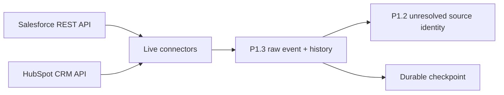

# P1.6 Live Salesforce and HubSpot Ingestion

P1.6 adds reusable live connectors while keeping the existing P1.2 identity and P1.3 raw-history rules in control. Salesforce and HubSpot records are read from the vendor APIs, wrapped in the unchanged source-event envelope, stored raw-first, and left unresolved until a person approves identity evidence.



## Current Vendor Choices

These choices were checked against official vendor documentation on 2026-10-12.

| Platform | Implemented choice | Current vendor basis |
|---|---|---|
| Salesforce | OAuth 2.0 External Client App with browser authorization, Proof Key for Code Exchange (PKCE), and refresh token | Salesforce recommends External Client Apps for new integrations; Developer Edition includes API access. The connector uses the supported `latest` REST alias, QueryAll, sObject Get Updated, Get Deleted, and record resources. |
| HubSpot | Scoped Service Key, or an already-existing private-app bearer token | HubSpot recommends Service Keys for new in-account system-to-system integrations. The connector targets the stable `2026-09` CRM Objects API. |

Official references: [Salesforce OAuth authorization](https://developer.salesforce.com/docs/platform/api-rest/guide/intro-oauth-and-connected-apps.html), [Salesforce supported editions](https://developer.salesforce.com/docs/platform/api-rest/guide/intro-rest-compatible-editions.html), [Salesforce API versions](https://developer.salesforce.com/docs/platform/api-rest/guide/dome-versions.html), [Salesforce QueryAll](https://developer.salesforce.com/docs/platform/api-rest/guide/dome-queryall.html), [Salesforce Get Updated](https://developer.salesforce.com/docs/platform/api-rest/guide/resources-getupdated.html), [Salesforce Get Deleted](https://developer.salesforce.com/docs/platform/api-rest/guide/resources-getdeleted.html), [HubSpot 2026-09 release](https://developers.hubspot.com/changelog/fall-2026-spotlight), and [HubSpot Service Keys](https://developers.hubspot.com/changelog/legacy-private-app-creation-sunset).

## Implementation Map

| Component | Responsibility |
|---|---|
| [`http.py`](../src/sai_revenueos_connectors/http.py) | HTTPS, timeouts, bounded exponential backoff, `Retry-After`, and redacted diagnostics. |
| [`salesforce.py`](../src/sai_revenueos_connectors/salesforce.py) | Salesforce OAuth refresh, QueryAll, pagination, updated/deleted polling, and safe test seeding. |
| [`hubspot.py`](../src/sai_revenueos_connectors/hubspot.py) | HubSpot scoped-token requests, date-versioned API pagination/search, archived polling, and safe test seeding. |
| [`runner.py`](../src/sai_revenueos_connectors/runner.py) | Initial/incremental orchestration, five-minute overlap, error isolation, and checkpoint protection. |
| P1.3 [`SourceStore`](../src/sai_revenueos_sources/store.py) | Raw-first events, immutable history, tombstones, current state, deterministic replay, and durable checkpoints. |
| P1.2 [`IdentityStore`](../src/sai_revenueos_identity/store.py) | Four-part source identity and unresolved resolution case; no automatic mapping. |
| [`live-ingestion-policy.v1.json`](../contracts/live-ingestion-policy.v1.json) | Versioned API, reliability, seed-safety, storage, and scope boundary. |

## Run the Credential-Free Demonstration

```bash
python3 projects/01-data-foundation/scripts/demo_live_ingestion.py
```

This runs the real connector and storage code against scripted API replies. Its default output is 14 lines.

```bash
python3 projects/01-data-foundation/scripts/demo_live_ingestion.py --verbose
```

This shows the complete mock requests, raw input, stored event, before/after values, duplicate replay, API failure, checkpoint, and recovery.

```bash
PYTHONPATH=projects/01-data-foundation/src python3 -c "import inspect; from sai_revenueos_connectors import LiveIngestionRunner; print(inspect.getsource(LiveIngestionRunner.sync))"
```

This prints the exact orchestration function used by mock and live runs.

## Configure Live Authentication Safely

Credentials are saved under ignored `generated-data/p16-live/credentials/` files with mode `600`. They are never printed. Do not paste a credential into chat.

### Salesforce Developer Edition

1. In Salesforce Setup, open **External Client App Manager** and create a local External Client App.
2. Enable OAuth and set the callback URL to `http://localhost:8765/callback`.
3. Add **Manage user data via APIs (`api`)** and **Perform requests at any time (`refresh_token`, `offline_access`)**.
4. Enable PKCE. For this local desktop flow, do not require a client secret unless you deliberately want to store one locally.
5. Copy the Consumer Key, then run:

```bash
python3 projects/01-data-foundation/scripts/configure_live_auth.py salesforce
```

The command opens Salesforce in your browser. Sign in there; the local script receives the authorization code and stores the returned tokens without displaying them.

### HubSpot Free

1. In HubSpot, open **Settings → Integrations → Service Keys**.
2. Create a key named `SAI RevenueOS P1.6` with Company, Contact, and Deal read scopes. Add Company write scope only for the marked Globex seeding exercise.
3. Note your portal/account ID, then run:

```bash
python3 projects/01-data-foundation/scripts/configure_live_auth.py hubspot --tenant YOUR_PORTAL_ID
```

The token prompt is hidden. An existing scoped private-app token also works, but Service Keys are the current choice for new lightweight integrations.

## Verify the Real Accounts

Each command is explicit about the only external write it can make.

```bash
python3 projects/01-data-foundation/scripts/run_live_ingestion.py --platform salesforce --mode initial --objects Account --seed-globex --confirm-test-write --verbose
```

Creates or confirms only the marked Salesforce test Account, retrieves it through the real API, and shows its stored raw event.

```bash
python3 projects/01-data-foundation/scripts/run_live_ingestion.py --platform hubspot --mode initial --objects Company --seed-globex --confirm-test-write --verbose
```

Creates or confirms only the marked HubSpot test Company, retrieves it through the real API, and shows its stored raw event.

```bash
python3 projects/01-data-foundation/scripts/run_live_ingestion.py --platform salesforce --mode incremental --objects Account --update-globex --confirm-test-write --verbose
```

Changes only the marked Salesforce test Account name, polls the real incremental endpoints, and stores the new version.

```bash
python3 projects/01-data-foundation/scripts/run_live_ingestion.py --platform hubspot --mode incremental --objects Company --update-globex --confirm-test-write --verbose
```

Changes only the marked HubSpot test Company name, polls the real incremental endpoints, and stores the new version.

Repeat either incremental command without `--update-globex --confirm-test-write`. A repeated source version is replayed rather than added as duplicate history.

## Failure and Recovery

- HTTP `408`, `429`, and selected `5xx` responses use bounded retries; `429` honors `Retry-After`.
- A network or processing failure stops that object stream and leaves its checkpoint before the gap.
- Other object streams receive separate results.
- The next poll starts five minutes before the checkpoint and reuses deterministic event IDs.
- Salesforce `LastViewedDate` and `LastReferencedDate` change when records are read. They remain in the first raw response but are excluded, with the API `attributes` wrapper, from source-version identity. Every business field remains part of identity, so a real value change still produces a new event.
- A malformed event remains in raw history with its error and does not move the checkpoint.

Run the mocked recovery acceptance scenarios:

```bash
python3 -m unittest projects/01-data-foundation/tests/test_live_connectors.py -v
```

## Small Exercise

After the HubSpot initial verification passes, edit the marked Globex Company's `name` in the HubSpot user interface. Run the HubSpot incremental command without any write flags. Predict the new raw-history count, then use `--verbose` to confirm the changed source value and unchanged unresolved identity status.

## Boundaries and Limitations

- Mocked behavior is verified in CI; Salesforce and HubSpot live status must be reported separately after authenticated calls.
- No credential is committed or sent to GitHub Actions.
- No automatic identity approval, merge, survivorship decision, or P1.4 write-back delivery occurs.
- Seeding and updates require explicit flags and stop on any unmarked-domain collision.
- HubSpot deletion detection polls archived objects because CRM search excludes archived records.
- Salesforce delete-log retention and access rules are vendor-controlled; periodic reconciliation remains necessary.
- A no-change poll does not create a synthetic event, so its data checkpoint stays unchanged and the safe overlap is read again.
- Webhook receivers, scheduling, cloud object storage, Snowflake, downstream workflows, and P1.7 are not implemented.
