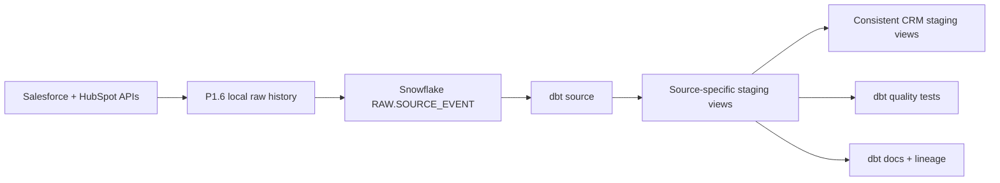

# P1.7 Snowflake + dbt Core Staging

P1.7 copies the existing P1.3/P1.6 source-event history into Snowflake RAW and uses dbt Core to create typed staging views. Source records remain separate, complete payloads remain queryable, and no identity match or CRM write-back occurs.

**Current status:** complete. The authorized Snowflake account, duplicate-safe RAW load, dbt build/tests, documentation, Globex queries, and isolated expected-failure demonstration all passed on 2026-10-12.



## Implementation Map

| Component | Responsibility |
|---|---|
| [`bootstrap.sql`](../warehouse/snowflake/bootstrap.sql) | Creates the X-Small warehouse, credit monitor, database, schemas, RAW table, and least-privilege roles. |
| [`pat_auth_setup.sql`](../warehouse/snowflake/pat_auth_setup.sql) | Creates two service users, a local network restriction, and separate 30-day role-restricted Programmatic Access Tokens (PATs). |
| [`configure_snowflake_auth.py`](../scripts/configure_snowflake_auth.py) | Stores both PATs in one ignored local file with `600` permissions and hidden input. |
| [`loader.py`](../src/sai_revenueos_warehouse/loader.py) | Atomically inserts new event IDs, replays exact events, and rejects conflicting history. |
| [`load_source_events_to_snowflake.py`](../scripts/load_source_events_to_snowflake.py) | Loads the ignored P1.6 SQLite history without printing payloads. |
| [`dbt_project.yml`](../warehouse/dbt/dbt_project.yml) | Defines the dbt Core project and staging-view defaults. |
| [`stg_source_events.sql`](../warehouse/dbt/models/staging/shared/stg_source_events.sql) | Safely types timestamps and labels latest and late-arriving versions. |
| Source-specific models | Normalize all four Salesforce and three HubSpot v1 objects. |
| [`stg_crm_companies.sql`](../warehouse/dbt/models/staging/shared/stg_crm_companies.sql) | Gives Accounts and Companies consistent fields without merging identities. |
| [`stg_crm_people.sql`](../warehouse/dbt/models/staging/shared/stg_crm_people.sql) | Gives Leads and Contacts consistent person fields for P1.8 while preserving source identities. |
| dbt data tests | Check keys, required fields, relationships, types, payload identity, and history integrity. |

## 1. Prepare a Snowflake Account

If you do not already have a Snowflake account, use the official [Snowflake signup page](https://signup.snowflake.com/) and choose a trial only if its terms are acceptable. Stop before entering payment details or enabling a paid service you do not intend to use.

Sign in to Snowsight, open a SQL worksheet, select `ACCOUNTADMIN`, review [`bootstrap.sql`](../warehouse/snowflake/bootstrap.sql), and run it once. Resource monitors can only be created and assigned by an account administrator.

The setup creates:

- one `XSMALL` warehouse that suspends after 60 idle seconds;
- one-credit monthly monitoring with notification, suspension, and immediate-suspension thresholds;
- one database with `RAW` and `STAGING` schemas;
- separate loader and dbt roles;
- no Snowpipe, task, serverless feature, or scheduled process.

Snowflake notes that auto-suspend reduces idle compute, while resource monitors must be assigned to a warehouse before they act. See the official [warehouse overview](https://docs.snowflake.com/en/user-guide/warehouses-overview) and [resource monitor guide](https://docs.snowflake.com/en/user-guide/resource-monitors).

## 2. Install dbt Core Locally

From the repository root:

```bash
python3.12 -m venv .venv
.venv/bin/python -m pip install -r projects/01-data-foundation/warehouse/requirements-dbt.txt
```

The pinned adapter installs dbt Core and the Snowflake Python Connector into the ignored virtual environment.

## 3. Configure Role-Restricted PATs

Run [`pat_auth_setup.sql`](../warehouse/snowflake/pat_auth_setup.sql) deliberately in Snowsight. It creates separate service users for loading and dbt, restricts them to the current client network address, and gives each user only its matching role. Run the two token statements separately because each secret is displayed once.

Store both secrets through hidden prompts; never put them in Git, shell history, logs, or chat:

```bash
.venv/bin/python projects/01-data-foundation/scripts/configure_snowflake_auth.py \
  --account YOUR_ORGANIZATION-YOUR_ACCOUNT
```

The script writes ignored `generated-data/p17-snowflake/credentials.json`, restricts it to mode `600`, and keeps loader and dbt credentials separate. Verify the dbt connection without printing a token:

```bash
.venv/bin/python projects/01-data-foundation/scripts/run_snowflake_dbt.py debug
```

PATs expire after 30 days and must be rotated manually. Snowflake requires a network policy for service-user PATs and recommends a role restriction; see the official [PAT guide](https://docs.snowflake.com/en/user-guide/programmatic-access-tokens).

## 4. Load P1.6 History into RAW

```bash
.venv/bin/python projects/01-data-foundation/scripts/load_source_events_to_snowflake.py
```

Run the same command a second time. The second result must report `inserted=0` and replay every selected event. A reused event ID with a different envelope hash fails and rolls back the batch.

## 5. Build and Test Staging

```bash
.venv/bin/python projects/01-data-foundation/scripts/run_snowflake_dbt.py build --exclude tag:failure_demo
```

The normal build excludes only the intentionally bad learning fixture. dbt data tests return failing rows and exit nonzero when a rule is violated; see the official [data-test guide](https://docs.getdbt.com/docs/build/data-tests).

Generate the catalog and lineage artifacts:

```bash
.venv/bin/python projects/01-data-foundation/scripts/run_snowflake_dbt.py docs generate
.venv/bin/python projects/01-data-foundation/scripts/run_snowflake_dbt.py docs serve
```

## 6. Query the Real Globex Flow

RAW history:

```sql
SELECT event_id,
       source_updated_at,
       raw_payload_json:properties:name::STRING AS company_name
FROM SAI_REVENUEOS.RAW.SOURCE_EVENT
WHERE source_system = 'hubspot'
  AND source_object_type = 'Company'
  AND raw_payload_json:properties:domain::STRING = 'globex-p16.invalid'
ORDER BY TRY_TO_TIMESTAMP_TZ(source_updated_at), received_at, event_id;
```

Standardized staging history:

```sql
SELECT event_id,
       source_object_id,
       name,
       source_updated_at,
       is_latest_source_version,
       is_late_arriving
FROM SAI_REVENUEOS.STAGING.STG_HUBSPOT_COMPANIES
WHERE domain = 'globex-p16.invalid'
ORDER BY source_updated_at, observed_at, event_id;
```

Run the 13-line guided result, or add `--verbose` to print both SQL statements and complete rows:

```bash
.venv/bin/python projects/01-data-foundation/scripts/demo_snowflake_dbt.py
```

## 7. Run the Expected Failure Safely

```bash
.venv/bin/python projects/01-data-foundation/scripts/demo_dbt_failure.py
```

The script seeds one isolated row whose required company name is `NULL`, confirms the dbt `not_null` test fails, and removes the isolated table. Add `--verbose` for the complete dbt output.

## Credential-Free Verification

```bash
python3 projects/01-data-foundation/scripts/validate_dbt_project.py
python3 -m unittest discover -s projects/01-data-foundation/tests -v
SNOWFLAKE_ACCOUNT=ci_dummy SNOWFLAKE_USER=ci_dummy SNOWFLAKE_DBT_TOKEN=ci_parse_only .venv/bin/dbt parse --no-partial-parse --project-dir projects/01-data-foundation/warehouse/dbt --profiles-dir projects/01-data-foundation/warehouse/dbt
```

GitHub Actions runs these checks with dummy identifiers and never contacts Snowflake.

## Boundaries and Limitations

- The RAW loader is manually invoked; no scheduler, Snowpipe, task, or webhook exists.
- Staging views standardize source records but do not create canonical matches or enforce P1.4 survivorship; P1.8 performs those separate governed steps.
- Relationship tests warn for references outside a partial source extract; production completeness rules remain future work.
- Resource monitors control assigned warehouse compute, not every possible Snowflake charge. P1.7 does not enable serverless features.
- The 30-day service tokens and current-address network restriction require manual rotation or update when they expire or the authorized network changes.
- P1.8 is complete and consumes the shared company and people views. P1.9 canonical models have not started.

## Authenticated Acceptance Evidence

On 2026-10-12:

- both restricted service connections succeeded without a human password;
- the loader inserted 39 immutable events into an empty RAW table;
- the immediate replay inserted 0 rows and recognized all 39 existing events;
- dbt created 9 staging views and passed 63 production data tests (`PASS=72`, including model builds);
- dbt generated `catalog.json` for documentation and lineage;
- the Globex demonstration preserved 3 HubSpot history rows and standardized the latest updated name;
- the isolated `NULL` company-name fixture failed its required-value test and was removed afterward.

## P1.8 Extension Evidence

On 2026-10-13, P1.8 added the shared people view without changing the accepted P1.7 RAW or source-specific models. The restricted dbt role built 10 views and passed 68 production data tests (`PASS=78`, including model builds). The read-only P1.8 verifier then read actual company staging rows and completed the Globex review flow using only a temporary local identity-database copy.
