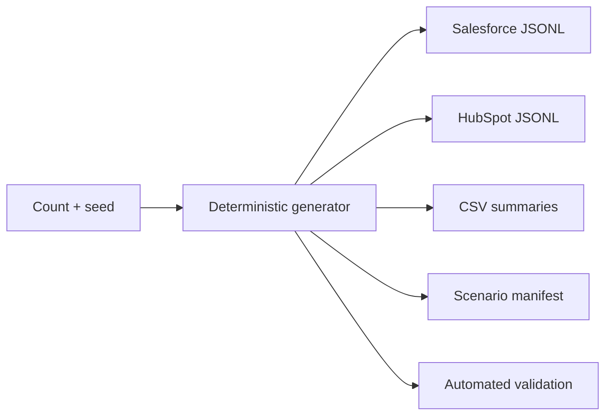

# P1.5 Synthetic GTM Data

## What It Does

P1.5 generates a fictional, connected business-to-business Software as a Service (B2B SaaS) ecosystem. It includes companies, parent/subsidiary and acquisition relationships, people, employment history, Salesforce Leads and Contacts, HubSpot Contacts, Opportunities, Deals, and canonical Activity fixtures.

The data is for learning and automated testing. It is not production data, vendor-exported data, or a deployed pipeline.



## Reused P1 Boundaries

| Existing component | How P1.5 reuses it |
|---|---|
| P1.2 identifiers | Canonical fixture IDs use the approved entity prefixes and UUIDv7 layout. |
| P1.2 identity store | The demo proves matching Salesforce and HubSpot records remain unresolved with no active crosswalk. |
| P1.3 contracts | Every source event uses the existing envelope and Salesforce/HubSpot object definitions. |
| P1.4 policy | Expected lifecycle and Opportunity-stage conflicts keep Salesforce as the approved authority. |
| Canonical contract | Relationships use the unchanged Account, Person, Opportunity, and Activity meanings. |

Activity rows are canonical fixtures. P1.3 does not define Salesforce Task or HubSpot Engagement source contracts, so P1.5 does not pretend those objects are ingestible today.

## Generated Records

| Company preset | People | Opportunities | Activities | Source events |
|---:|---:|---:|---:|---:|
| 25 | 50 | 25 | 50 | 205 |
| 250 | 500 | 250 | 500 | 2,005 |
| 2,500 | 5,000 | 2,500 | 5,000 | 20,005 |

Custom sizes from 3 through 100,000 companies are accepted. Version 1 creates two people, one Opportunity, and two Activities per company.

## Intentional Problems

The scenario manifest identifies each deliberate issue and its expected safe outcome:

- exact event replay and duplicate HubSpot company records;
- missing optional company, person, and Opportunity values;
- conflicting lifecycle and sales-stage values;
- the Globex acquisition of Northstar without an Account merge;
- the Northstar rebrand with effective-dated name history;
- Sarah Kim's job change and stale employer evidence;
- ambiguous identity evidence that requires review;
- a late Globex event that appends history without replacing newer state.

Unknown identities are never automatically approved or merged.

## Output Files

[`write_dataset()`](../src/sai_revenueos_synthetic/writer.py) writes:

- one complete versioned JSON dataset;
- Salesforce and HubSpot JSON Lines (JSONL) source events;
- CSV summaries for companies, names, relationships, people, employment, Opportunities, and Activities;
- one versioned scenario manifest with counts, issues, expected outcomes, and boundaries.

The recommended `generated-data/` directory is ignored by Git. Large generated datasets should be recreated from their count and seed rather than committed.

## Run It

From the repository root, run the concise Globex demonstration:

```bash
python3 projects/01-data-foundation/scripts/demo_synthetic_data.py
```

Show the complete generated records, standardized source values, identity state, authority conflict, and manifest:

```bash
python3 projects/01-data-foundation/scripts/demo_synthetic_data.py --verbose
```

Generate the small preset into the ignored output directory:

```bash
python3 projects/01-data-foundation/scripts/generate_synthetic_gtm_data.py --companies 25 --seed 42
```

Generate a custom dataset:

```bash
python3 projects/01-data-foundation/scripts/generate_synthetic_gtm_data.py --companies 75 --seed 2026 --output generated-data/my-run
```

Run the P1.5 acceptance scenarios:

```bash
python3 -m unittest projects/01-data-foundation/tests/test_synthetic_data.py -v
```

## Small Exercise

Generate 25 companies with seed `43`, then repeat with the same seed in a second output directory. Confirm both terminal fingerprints match and compare the two `scenario-manifest.v1.json` files. Change only the seed to `44` and explain why the counts stay constant while the fingerprint changes.

## Important Boundaries

- No live Salesforce or HubSpot connection, authentication, webhook, or API request exists.
- The generator does not perform automatic identity matching, crosswalk approval, or canonical merging.
- Activities are fixtures, not source connector output.
- No subscription, renewal, billing, revenue-intelligence, or Customer 360 workflow is implemented.
- The 100,000-company limit protects a local in-memory reference; this is not a distributed data generator.
