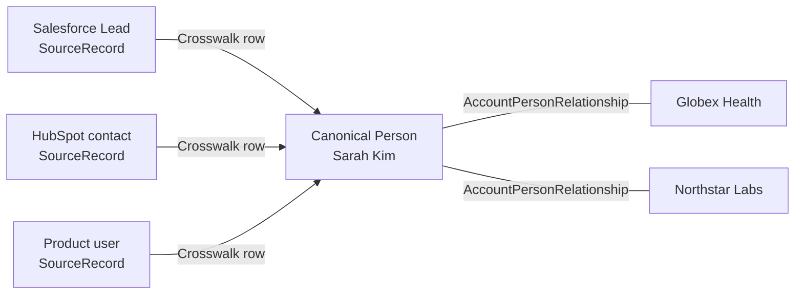

# ADR-0001: Use One Person Identity for One Human

- **Decision ID:** D001
- **Status:** Accepted
- **Scope:** P1 canonical identity

## The Problem

One human can appear in a Customer Relationship Management (CRM) system, marketing platform, product application, and support tool. Creating a Person for every source record would duplicate the human and split their history.

## Visual Diagram

Arrows show logical mappings and relationships, not an automated workflow.

## Simple Example

Sarah Kim has Salesforce, HubSpot, and product-user records while working at Globex Health. Confirmed crosswalk rows connect those source records to one canonical Person. When Sarah moves to Northstar Labs, the Globex relationship closes and a Northstar relationship begins. Her `person_id` does not change.

## How We Implement It

| Component | Responsibility |
|---|---|
| `Person.person_id` | Provides Sarah's permanent, source-independent identity. |
| `SourceRecord` | Preserves each Salesforce, HubSpot, or product representation. |
| `ExternalIdentityCrosswalk` | Maps each confirmed source record to the canonical Person. |
| `AccountPersonRelationship` | Stores effective-dated employment and other Account affiliations. |

## Why This Design

- **Rejected alternative:** Create a Person per source record or use email as the Person ID.
- **Why rejected:** Source records duplicate the human, while email can change, be shared, or be missing.
- **Why this is better:** One Person preserves continuous history while source and employment facts remain separate and auditable.
- **Tradeoff:** Identity resolution must be conservative because a bad match can affect many downstream records and may require controlled merge or unmerge.
