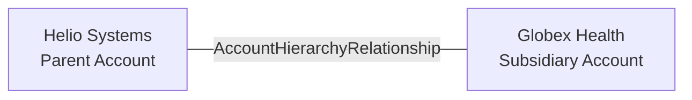

# ADR-0002: Keep Parent and Subsidiary Accounts Separate

- **Decision ID:** D002
- **Status:** Accepted
- **Scope:** P1 organization identity

## The Problem

A corporate group can contain a parent company and several subsidiaries. Combining them into one Account would attach contracts, revenue, users, and support activity to the wrong legal or operating company.

## Visual Diagram

The line is a logical, effective-dated relationship between two independent Accounts.

## Simple Example

Helio Systems owns Globex Health, but Globex signs its own contract and supports its own users. RevenueOS gives each company a separate `account_id`. An effective-dated hierarchy relationship connects Globex to Helio. Globex revenue stays with Globex while group reporting can include both Accounts.

## How We Implement It

| Component | Responsibility |
|---|---|
| `Account.account_id` | Gives each parent or subsidiary its own canonical identity. |
| `AccountHierarchyRelationship.parent_account_id` | Identifies the parent Account. |
| `AccountHierarchyRelationship.child_account_id` | Identifies the subsidiary Account. |
| `relationship_type`, `valid_from`, `valid_to` | Describe the hierarchy and when it is valid. |
| Hierarchy rules | Define self-links and cycles as invalid; later physical implementations must enforce them. |

## Why This Design

- **Rejected alternative:** Flatten the corporate group into one Account or copy parent fields onto subsidiaries.
- **Why rejected:** Flattening loses entity-level facts, while copied fields become stale and erase ownership history.
- **Why this is better:** Independent Accounts preserve legal and operational detail while explicit relationships support rollups.
- **Tradeoff:** Queries must traverse the hierarchy, and validation must prevent cycles or conflicting active parents.
