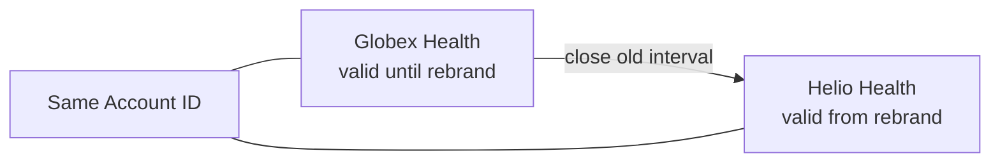

# ADR-0003: Preserve Important Account History Selectively

- **Decision ID:** D003
- **Status:** Accepted
- **Scope:** P1 temporal modeling

## The Problem

Company names, domains, and parent relationships change. Overwriting those values would make historical reports and identity decisions show facts that were not valid at the time.

## Visual Diagram

The arrow shows the change between two non-overlapping validity intervals, not a processing workflow.

## Simple Example

Globex Health closes an Opportunity and later rebrands as Helio Health. RevenueOS closes the old name interval and starts a new one. A report for the earlier period still shows Globex Health. The canonical `account_id` stays the same.

## How We Implement It

| Component | Responsibility |
|---|---|
| `AccountNameHistory` | Stores legal names, trade names, aliases, and preferred-name intervals. |
| `AccountDomainHistory` | Stores normalized domains and primary-domain intervals. |
| `AccountHierarchyRelationship` | Stores parent-child relationships over time. |
| `valid_from`, `valid_to` | Define half-open intervals: the start is included and the end is excluded. |

## Why This Design

- **Rejected alternative:** Keep only the latest value or apply Slowly Changing Dimension Type 2 (SCD Type 2) history to every field.
- **Why rejected:** Current-only values destroy history, while universal history adds complexity without a clear business need.
- **Why this is better:** Selective SCD Type 2 preserves identity-sensitive facts needed for matching, attribution, and as-of reporting.
- **Tradeoff:** Queries need time-aware joins, and interval rules must prevent overlapping preferred names, primary domains, or hierarchy links.
