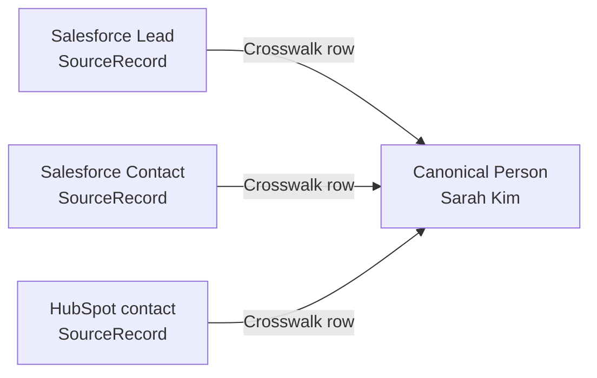

# ADR-0004: Model Lead and Contact as Source Records

- **Decision ID:** D004
- **Status:** Accepted
- **Scope:** P1 person modeling

## The Problem

Customer Relationship Management (CRM) platforms use Lead and Contact as operational stages. Treating those records as separate canonical people would split one human's history when a Lead converts or appears in another system.

## Visual Diagram

Arrows show logical source-to-canonical mappings, not a Lead-conversion workflow.

## Simple Example

Sarah Kim begins as Salesforce Lead `00Q-17` and later becomes Contact `003-82`. She also appears as a HubSpot contact. RevenueOS preserves all three SourceRecords and can map them to Sarah's one canonical Person. The conversion does not create a new human identity.

## How We Implement It

| Component | Responsibility |
|---|---|
| `SourceRecord.source_object_type` | Records whether the source object is a Lead, Contact, or another source type. |
| `SourceRecord.source_record_id` | Preserves each source representation and its provenance. |
| `ExternalIdentityCrosswalk` | Maps confirmed source records to the canonical Person. |
| `Person.person_id` | Provides one durable identity for the human. |

## Why This Design

- **Rejected alternative:** Create canonical Lead and Contact entities or replace the Lead when conversion occurs.
- **Why rejected:** Canonical lifecycle types duplicate the human, while replacement destroys source and conversion history.
- **Why this is better:** Source-specific stages remain auditable without fragmenting Person identity.
- **Tradeoff:** Consumers needing Lead- or Contact-specific fields must join to source lineage, and ingestion must preserve conversion evidence.
