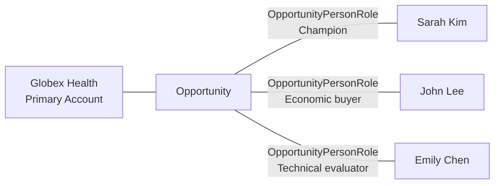

# ADR-0005: Give Each Opportunity One Primary Account and Many People

- **Decision ID:** D005
- **Status:** Accepted
- **Scope:** P1 revenue model

## The Problem

A sales Opportunity needs one clear buying company, but a business purchase can involve many people. Repeated participant columns limit the buying committee, while several primary Accounts make pipeline ownership ambiguous.

## Visual Diagram

Lines show canonical relationships; they do not represent the order of sales activity.

## Simple Example

Globex Health evaluates an analytics product. Sarah Kim is the champion, John Lee is the economic buyer, and Emily Chen is the technical evaluator. The Opportunity points to Globex as its one primary Account. Each person participates through a separate role relationship.

## How We Implement It

| Component | Responsibility |
|---|---|
| `Opportunity.primary_account_id` | Identifies the one primary buying Account. |
| `OpportunityPersonRole.opportunity_id` | Connects a participation record to the Opportunity. |
| `OpportunityPersonRole.person_id` | Connects the participation record to a Person. |
| `role_type`, `influence_level`, `is_primary_contact` | Describe how the Person participates. |
| `valid_from`, `valid_to` | Preserve role changes over time. |

## Why This Design

- **Rejected alternative:** Add fixed contact columns to Opportunity or allow several primary Accounts.
- **Why rejected:** Fixed columns cannot support changing committees, while several primary Accounts weaken attribution.
- **Why this is better:** One buying Account keeps pipeline ownership clear, and a relationship entity supports any number of people and roles.
- **Tradeoff:** Buying-committee analysis requires joins, and partner or reseller participation must be modeled explicitly.
