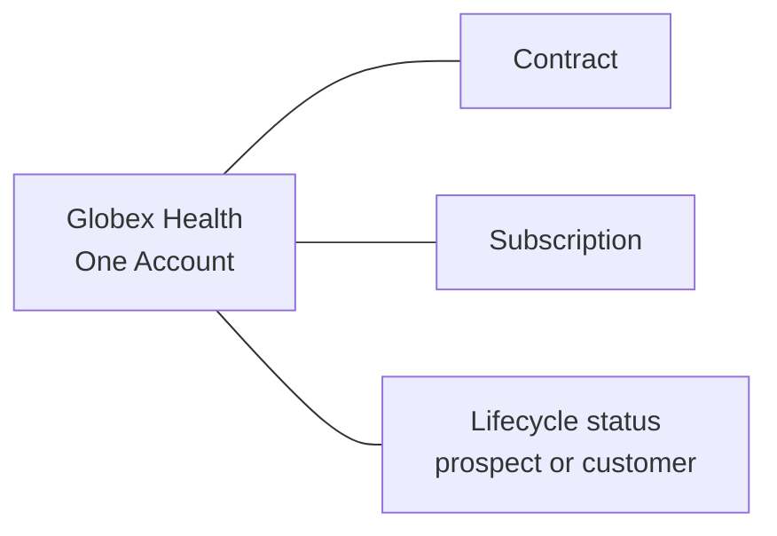

# ADR-0006: Treat Customer as an Account Lifecycle Status

- **Decision ID:** D006
- **Status:** Accepted
- **Scope:** P1 commercial identity

## The Problem

A prospect can become a customer, renew, pause service, or stop being a customer. Creating a new company identity at each change would split its marketing, sales, billing, product, and support history.

## Visual Diagram

Lines show separate commercial records related to one Account, not an implemented status-calculation workflow.

## Simple Example

Globex Health begins as a prospect and later signs a Contract and starts a Subscription. RevenueOS keeps the same Account and can change its lifecycle status to customer under a governed rule. Contract and Subscription retain their own identities and histories. The authoritative status-derivation rule is still deferred.

## How We Implement It

| Component | Responsibility |
|---|---|
| `Account.lifecycle_status` | Holds the governed business lifecycle state. |
| `customer_since_at`, `ended_customer_at` | Record selected customer-status timing. |
| `Contract` | Stores the signed agreement independently from Account status. |
| `Subscription` | Stores time-bounded service entitlement independently from the Contract. |
| Future governed derivation rule | Will define who may calculate and write customer status; it is not yet implemented. |

## Why This Design

- **Rejected alternative:** Create a separate Customer entity or let every report infer customer state independently.
- **Why rejected:** A second entity duplicates the company, while local report rules produce conflicting answers.
- **Why this is better:** One Account keeps the organization's history together while commercial records preserve agreement and service detail.
- **Tradeoff:** RevenueOS still needs one approved derivation rule and clear write authority before customer status can be calculated operationally.
