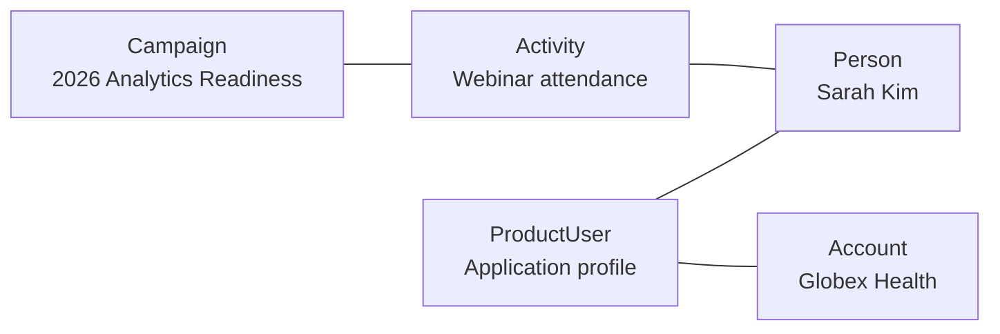

# ADR-0007: Keep Activity, Campaign, and ProductUser Distinct

- **Decision ID:** D007
- **Status:** Accepted
- **Scope:** P1 engagement model

## The Problem

A marketing initiative, an individual interaction, and a product profile describe different things. Combining them into one generic record would blur their meaning, lifecycle, provenance, and metrics.

## Visual Diagram

Lines show logical associations among distinct entities, not a required execution sequence.

## Simple Example

Globex Health joins the “2026 Analytics Readiness” Campaign. Sarah Kim's webinar attendance is represented as an Activity, and her application profile is represented as a ProductUser. RevenueOS keeps the initiative, event, and product profile separate. Resolved links can connect them to the same Person and Account.

## How We Implement It

| Component | Responsibility |
|---|---|
| `Campaign` | Represents a marketing initiative and its active period. |
| `Activity` | Represents a time-stamped interaction and optional canonical context. |
| `ProductUser` | Represents an application profile, tenancy, and usage identity. |
| `person_id`, `account_id`, `opportunity_id`, `campaign_id` | Connect records to canonical context when known. |
| `source_record_id`, `resolution_status` | Preserve source provenance and allow unresolved records. |

## Why This Design

- **Rejected alternative:** Store every engagement as one generic record or add campaign and product fields to Activity.
- **Why rejected:** A generic record hides important differences, while mixed fields create sparse and confusing rows.
- **Why this is better:** Separate entities produce clear campaign, interaction, and product metrics while sharing canonical context when resolved.
- **Tradeoff:** Analysis requires explicit joins, and consumers must handle records whose canonical identity is not yet resolved.
