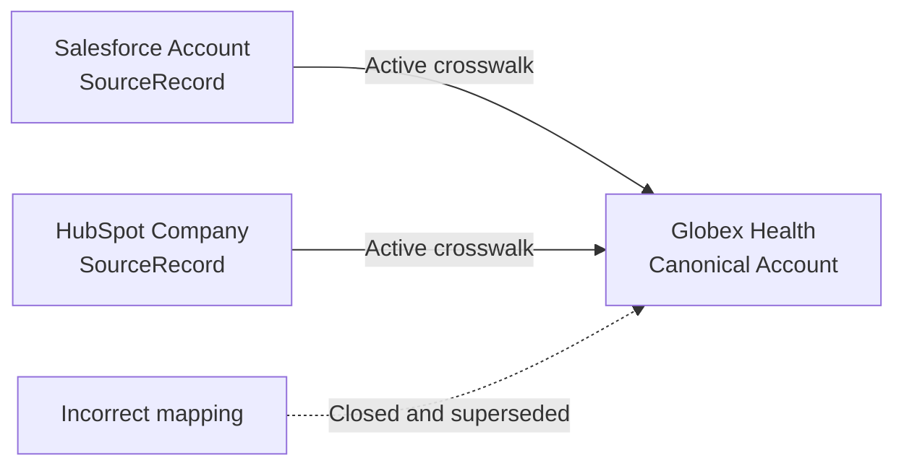

# ADR-0008: Use an Auditable External-ID Crosswalk

- **Decision ID:** D008
- **Status:** Accepted
- **Scope:** P1 source-to-canonical identity

## The Problem

One canonical entity can have records in several systems, and a match can later prove wrong. Storing vendor identifiers directly on canonical entities does not scale and makes corrections difficult to explain.

## Visual Diagram

Arrows show effective-dated mappings from source records to one canonical Account, not ingestion steps.

## Simple Example

Salesforce Account `SF-1001` and HubSpot Company `HS-502` both describe Globex Health. A different HubSpot company is later mapped there by mistake. RevenueOS closes the incorrect crosswalk interval and appends a reviewed replacement. The original mapping remains available for audit.

## How We Implement It

| Component | Responsibility |
|---|---|
| `SourceRecord` | Identifies one source-system object without making it canonical truth. |
| `canonical_entity_type`, `canonical_entity_id` | Identify the supported canonical target. |
| `mapping_status`, `mapping_method`, `confidence` | Describe the mapping outcome and how it was established. |
| `valid_from`, `valid_to` | Preserve when each mapping was authoritative. |
| `supersedes_crosswalk_id`, `reviewed_by`, `reviewed_at` | Preserve correction lineage and review evidence. |

## Why This Design

- **Rejected alternative:** Add one vendor-ID column per system or use a vendor value as the canonical ID.
- **Why rejected:** Vendor columns do not support many records per source and couple identity to mutable external values.
- **Why this is better:** A separate crosswalk supports multiple systems, vendor-independent canonical IDs, and traceable corrections.
- **Tradeoff:** The system needs mapping governance, temporal uniqueness, reconciliation, and manual review; P1.2 proves these mechanics only in a local reference implementation.
