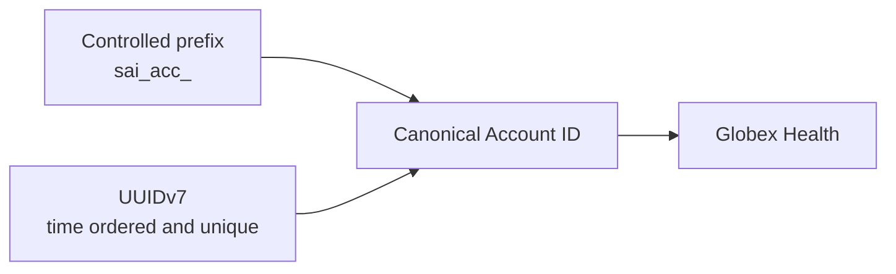

# ADR-0009: Generate Entity-Prefixed UUIDv7 Canonical IDs

- **Decision ID:** D009 (P1.2 Decision A)
- **Status:** Accepted and implemented in the reference layer
- **Scope:** P1 canonical identity creation

## The Problem

Canonical identifiers must stay stable when vendor records, company names, domains, or employers change. Sequential numbers need central allocation, while untyped random identifiers are harder for people to recognize and troubleshoot.

## Visual Diagram

The arrow shows identifier construction, not a data-processing pipeline.

## Simple Example

Globex Health receives an Account ID before it rebrands and changes its domain. RevenueOS combines the `sai_acc_` prefix with a Universally Unique Identifier version 7 (UUIDv7). The ID remains stable after those business changes. Its prefix also tells an operator that it identifies an Account.

## How We Implement It

| Component | Responsibility |
|---|---|
| `uuid7()` | Generates a Request for Comments (RFC) 9562 UUIDv7 without requiring `uuid.uuid7()`. |
| `PrefixedIDGenerator.generate()` | Combines the controlled entity prefix with the UUIDv7 value. |
| `validate_prefixed_id()` | Confirms the expected prefix, UUID version, and UUID variant. |
| Prefix registry | Maps supported entity types to prefixes such as `sai_acc_`, `sai_person_`, and `sai_opp_`. |
| Collision retry | Generates another value if the database already contains the candidate ID. |

## Why This Design

- **Rejected alternative:** Use vendor IDs, sequential integers, or random UUID version 4 (UUIDv4) values.
- **Why rejected:** Vendor IDs create source coupling, integers require central allocation, and UUIDv4 provides no creation-time ordering.
- **Why this is better:** Entity-prefixed UUIDv7 values are source-independent, distributed, recognizable, and roughly time ordered.
- **Tradeoff:** IDs are longer, prefixes require governance, and UUIDv7 exposes approximate creation time.
