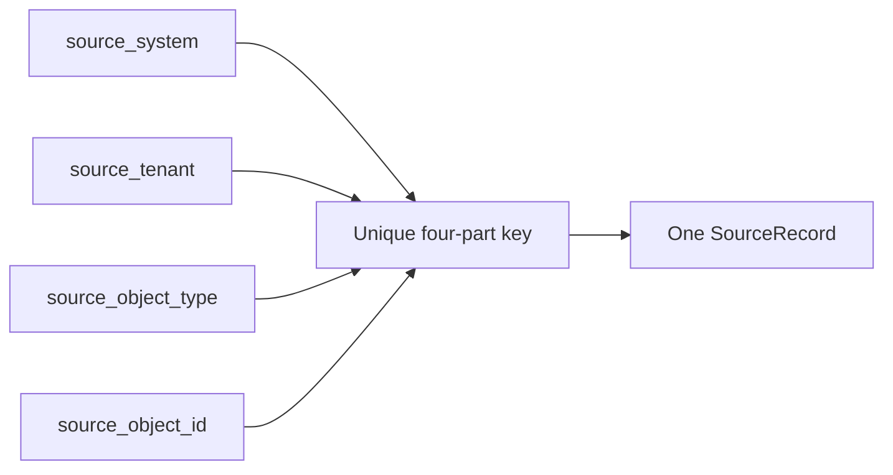

# ADR-0010: Use a Four-Part Source Identity and Idempotent Writes

- **Decision ID:** D010 (P1.2 Decision B)
- **Status:** Accepted and implemented in the reference layer
- **Scope:** P1 source identity

## The Problem

A vendor object identifier may repeat across systems, tenants, or object types. Retries and concurrent deliveries can also send the same record more than once, so application checks alone cannot guarantee one stable SourceRecord.

## Visual Diagram

The four inputs form one logical source identity; repeated writes resolve to the same SourceRecord.

## Simple Example

Salesforce identifier `001ABC` exists in both Globex Health's sandbox and production tenants. The production record is also delivered twice. RevenueOS includes system, tenant, object type, and object ID in the unique key. Both production deliveries return one SourceRecord without colliding with the sandbox record.

## How We Implement It

| Component | Responsibility |
|---|---|
| `normalize_source_identity()` | Validates and normalizes the four identity components under documented rules. |
| Original source fields | Preserve the exact values received for provenance. |
| Normalized four-part unique constraint | Prevents duplicate source identities in the database. |
| `get_or_create_source_record()` | Performs lookup and insert inside one atomic write transaction. |
| `source_observation` | Records distinct deliveries without creating duplicate SourceRecords. |
| `idempotency_operation` | Binds a governed command's retry key to its request and first result. |

## Why This Design

- **Rejected alternative:** Identify a record by object ID alone, system plus ID, or an unconstrained generated ID.
- **Why rejected:** Those choices can combine different tenants or object types and cannot prevent duplicate rows during retries.
- **Why this is better:** The complete vendor namespace plus database uniqueness gives one durable source identity under replay and concurrency.
- **Tradeoff:** Every connector must provide the four fields consistently, and normalization changes require careful migration because the key is permanent.
