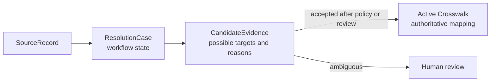

# ADR-0011: Separate Resolution Cases, Candidate Evidence, and Crosswalks

- **Decision ID:** D011 (P1.2 Decision C)
- **Status:** Accepted and implemented in the reference layer
- **Scope:** P1 identity resolution lifecycle

## The Problem

A possible identity match is not the same as approved identity truth. Writing the highest score directly to a crosswalk could turn uncertain evidence into an authoritative customer mapping.

## Visual Diagram

Arrows show the governed resolution path; only the active crosswalk is authoritative.

## Simple Example

A Northstar Labs source record has name and domain evidence for two plausible Accounts. RevenueOS records both candidates instead of choosing the highest score automatically. The case enters review because the result is ambiguous. Only an accepted candidate can produce an active crosswalk.

## How We Implement It

| Component | Responsibility |
|---|---|
| `ResolutionCase` | Tracks `unresolved`, `candidate`, `ambiguous`, `pending_review`, `resolved`, or `no_match`. |
| `CandidateEvidence` | Stores a possible target, evidence, confidence, policy version, and review disposition. |
| `propose_candidate()` | Adds candidate evidence without making it authoritative. |
| `request_manual_review()`, `decide_candidate()` | Enforce reviewed transitions for uncertain cases. |
| `ExternalIdentityCrosswalk` | Holds the approved active mapping; prior rows remain superseded or revoked. |

## Why This Design

- **Rejected alternative:** Put scores directly on the crosswalk or overwrite one combined status row.
- **Why rejected:** Those designs mix guesses with truth and lose the evidence and review history behind a decision.
- **Why this is better:** Workflow state, supporting evidence, and authoritative mappings remain explicit and independently auditable.
- **Tradeoff:** The model requires more tables and transitions, and the complete production matching engine remains deferred.
