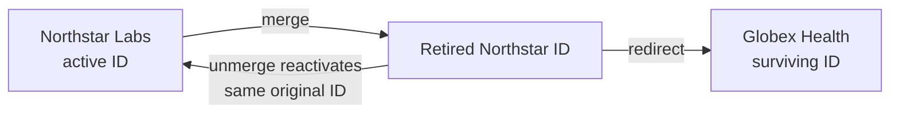

# ADR-0012: Preserve Identity and Audit History Through Correction, Merge, and Unmerge

- **Decision ID:** D012 (P1.2 Decision D)
- **Status:** Accepted and implemented in the reference layer
- **Scope:** P1 stewardship

## The Problem

Identity decisions can be wrong and must be corrected without deleting evidence or breaking historical references. A merge also needs a safe reversal path when later information shows that two identities should remain separate.

## Visual Diagram

Arrows show controlled identity state changes and the redirect retained after a merge.

## Simple Example

A steward incorrectly merges Northstar Labs into Globex Health after misreading an acquisition announcement. RevenueOS retires Northstar's ID, retains a redirect, and records every moved mapping. Unmerge reactivates the same Northstar ID when lineage is unchanged. Mappings changed after the merge go to human review instead of being restored blindly.

## How We Implement It

| Component | Responsibility |
|---|---|
| `correct_mapping()` | Closes the old crosswalk interval and appends a superseding mapping. |
| `merge_identities()` | Retires the losing ID, creates a redirect, and moves active mappings with lineage. |
| `identity_merge_event`, `merge_mapping_change` | Preserve immutable merge, unmerge, and mapping-change history. |
| `unmerge_identities()` | Reactivates the original ID and restores only mappings whose lineage is unchanged. |
| `audit_event` | Records the actor, operation, subject, time, and structured details. |

## Why This Design

- **Rejected alternative:** Delete and recreate identities or rewrite mappings in place.
- **Why rejected:** Deletion breaks references, while in-place rewrites hide prior truth and make recovery unreliable.
- **Why this is better:** Stable IDs, redirects, effective dates, and immutable lineage make mistakes explainable and reversible.
- **Tradeoff:** History grows, consumers must follow redirects, and unmerge may require manual review after later changes; a rebrand or acquisition never triggers automatic merge.
