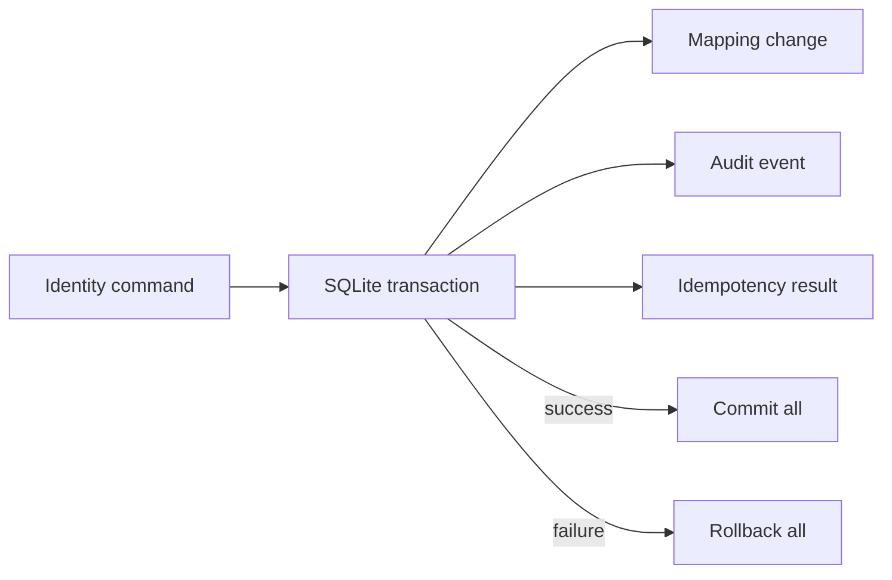

# ADR-0013: Prove Identity Rules with a Transactional SQLite Reference

- **Decision ID:** D013 (P1.2 Decision E)
- **Status:** Accepted and implemented in the reference layer
- **Scope:** P1 operational reference behavior

## The Problem

Documentation alone cannot prove that identity writes remain safe under retries, concurrency, or partial failure. Building a deployed production service at P1.2 would exceed the project boundary before the required data rules were proven.

## Visual Diagram

The transaction commits all related writes together or rolls all of them back.

## Simple Example

Two workers replay the same Globex Health source record while a mapping correction fails after closing the old row. SQLite serializes the competing write and database uniqueness preserves one SourceRecord. The failed correction rolls back its mapping, audit, and idempotency changes together. Globex keeps its previous active mapping.

## How We Implement It

| Component | Responsibility |
|---|---|
| `IdentityStore._transaction()` | Starts an immediate transaction, commits success, and rolls back failure. |
| SQLite constraints and triggers | Enforce uniqueness, valid state transitions, non-overlapping intervals, and immutable history. |
| `idempotency_operation` | Returns the first result for an exact retry and rejects key reuse with different input. |
| Write serialization and busy timeout | Protect concurrent local writes. |
| `reconcile()` | Reports invariant violations that should not exist in valid stored state. |
| Automated tests | Exercise concurrent connections, retries, and injected partial failures. |

## Why This Design

- **Rejected alternative:** Rely on documentation, in-memory objects, or deploy a production platform immediately.
- **Why rejected:** The first two cannot prove database behavior, while production deployment would cross the P1.2 scope boundary.
- **Why this is better:** Python and SQLite, an embedded Structured Query Language (SQL) database, provide an executable local specification with no external service dependency.
- **Tradeoff:** SQLite is not the production topology; a later service must preserve these semantics while adding authentication, deployment, observability, and reliable publication to Snowflake.
