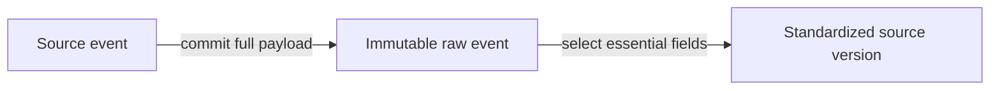

# ADR-0014: Preserve Raw Payloads Before Standardization

- **Decision ID:** D014 (P1.3 Decision A)
- **Status:** Accepted and implemented in the reference layer
- **Scope:** P1 source fidelity

## The Problem

Standardization keeps only fields known to be useful today. If RevenueOS discards the original Salesforce or HubSpot payload first, later requirements cannot recover omitted fields or explain how a standardized value was produced.

## Visual Diagram

The first arrow is the durability boundary: raw JSON is committed before field validation.

## Simple Example

A synthetic Globex Health Salesforce Account contains `Customer_Tier__c` and `AnnualRevenue`. P1.3 standardizes the Account name and domain first. The complete payload still retains both extra fields. A later phase can use them without re-fetching the source.

## How We Implement It

| Component | Responsibility |
|---|---|
| `source_event.raw_payload_json` | Stores every available payload field before standardization. |
| `payload_sha256` | Detects content changes and identifies the preserved payload. |
| `SourceStore._persist_raw_event()` | Commits raw input in its own transaction before essential-field processing. |
| `source_record_version.standardized_payload_json` | Stores the smaller contracted subset separately from raw JSON. |

## Why This Design

- **Rejected alternative:** Keep only standardized columns or archive raw data after processing.
- **Why rejected:** Both approaches can lose unknown fields when validation or processing fails.
- **Why this is better:** Raw-first storage preserves source fidelity and supports replay, debugging, and future field needs.
- **Tradeoff:** Full payload history uses more storage and requires retention, privacy, and access controls in production.
