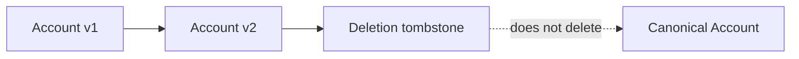

# ADR-0015: Keep Source History and Represent Deletions as Tombstones

- **Decision ID:** D015 (P1.3 Decision B)
- **Status:** Accepted and implemented in the reference layer
- **Scope:** P1 source history and deletion

## The Problem

Salesforce and HubSpot records change or disappear. Overwriting the latest row or deleting local history would hide what RevenueOS previously received and could wrongly remove a durable canonical identity.

## Visual Diagram

Arrows show successive immutable source versions; the canonical identity is separate.

## Simple Example

Globex Health's Salesforce domain changes and the source Account is later deleted. P1.3 retains the original version, the update, and a tombstone. The tombstone becomes the current source state. Any canonical Globex Account remains active.

## How We Implement It

| Component | Responsibility |
|---|---|
| `source_record_version` | Appends one immutable row for every successfully processed source event. |
| `is_tombstone` | Marks a deletion without removing earlier versions. |
| `source_current_state` | Points to the newest source version, including a tombstone. |
| P1.2 `canonical_identity` | Remains protected from deletion and is not changed by a source tombstone. |

## Why This Design

- **Rejected alternative:** Overwrite source rows or cascade a source deletion into canonical identity.
- **Why rejected:** Overwrites erase evidence, while cascading confuses a vendor record with the real business entity.
- **Why this is better:** Append-only versions preserve history and keep source lifecycle separate from canonical lifecycle.
- **Tradeoff:** History grows over time, and downstream consumers must interpret tombstones explicitly.
