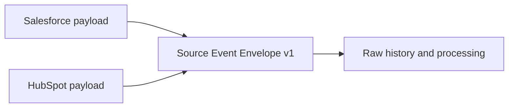

# ADR-0016: Use One Standard Source-Event Envelope

- **Decision ID:** D016 (P1.3 Decision C)
- **Status:** Accepted and implemented in the reference layer
- **Scope:** P1 source-event contract

## The Problem

Salesforce and HubSpot expose different payload shapes and cursor styles. Without a common envelope, every downstream component would need vendor-specific logic for identity, timing, tracing, event type, and replay metadata.

## Visual Diagram

Both connectors produce the same envelope while their payloads remain vendor-native.

## Simple Example

A synthetic Salesforce Account and HubSpot Company both describe Globex Health. Their payload fields remain different. Each event still carries the same origin, identifiers, timestamps, event type, tracing, and checkpoint sections. P1.3 can process both through one interface.

## How We Implement It

| Component | Responsibility |
|---|---|
| `source-event-envelope.v1.json` | Defines the versioned vendor-neutral event shape. |
| `SourceEvent.from_dict()` | Validates required sections, allowed fields, event types, and timezones. |
| `source` | Carries system, tenant, object type, and object ID. |
| `timestamps`, `tracing` | Carry source/observation time and trace/extraction identifiers. |
| `checkpoint` | Carries stream, opaque cursor, and extraction high watermark. |

## Why This Design

- **Rejected alternative:** Give each connector an unrelated event shape.
- **Why rejected:** Downstream code would duplicate validation, tracing, retry, and source-identity logic.
- **Why this is better:** One envelope standardizes operational metadata without flattening vendor payload semantics.
- **Tradeoff:** Envelope evolution needs versioning, and connectors must map their native metadata consistently.
