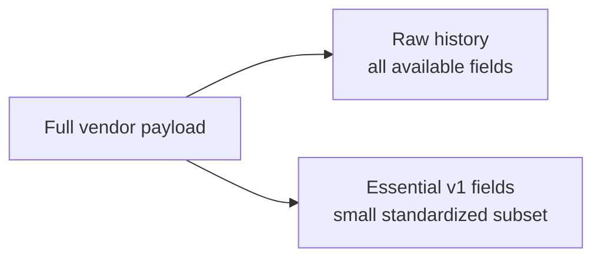

# ADR-0017: Standardize Essential Source Fields First

- **Decision ID:** D017 (P1.3 Decision D)
- **Status:** Accepted and implemented in the reference layer
- **Scope:** P1 Salesforce and HubSpot source contracts

## The Problem

Salesforce and HubSpot installations can expose hundreds of standard and custom fields. Modeling all of them before any source behavior is proven would create a large, unstable contract and delay useful validation.

## Visual Diagram

The compact standardized subset and full raw payload coexist; fields are not discarded.

## Simple Example

The synthetic Globex Salesforce Account includes name, website, owner, revenue, employee count, and a custom tier. The v1 contract standardizes identity-sensitive Account fields such as name and website. Revenue and custom tier stay in raw history. They can be added to a later contract when a governed use case requires them.

## How We Implement It

| Component | Responsibility |
|---|---|
| `salesforce-source.v1.json` | Covers Account, Lead, Contact, and Opportunity essential fields. |
| `hubspot-source.v1.json` | Covers Company, Contact, and Deal essential fields. |
| `SourceContractRegistry` | Loads the checked-in version 1 mappings. |
| `standardize_event()` | Validates required fields and emits only the contracted subset. |
| Raw payload storage | Preserves unknown, optional, nested, and custom fields unchanged in meaning. |

## Why This Design

- **Rejected alternative:** Standardize every available field or store only an untyped JSON blob.
- **Why rejected:** The first creates premature scope and churn; the second provides no dependable fields for current processing.
- **Why this is better:** A small contract is testable now while raw preservation protects future needs.
- **Tradeoff:** Consumers cannot treat an unmodeled raw field as governed until a later contract adds its meaning and validation.
