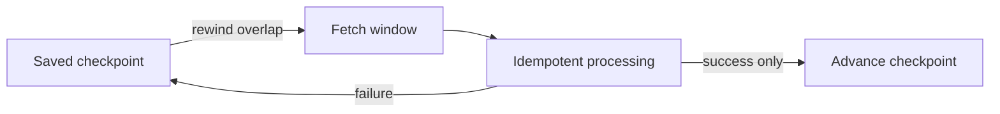

# ADR-0018: Use Checkpoints, Overlap, Idempotency, and Safe Replay

- **Decision ID:** D018 (P1.3 Decision E)
- **Status:** Accepted and implemented in the reference layer
- **Scope:** P1 connector recovery semantics

## The Problem

Connectors can stop mid-run, deliver duplicates, or expose late updates whose source timestamp falls before the last successful extraction. Advancing a checkpoint before durable processing could permanently skip a record.

## Visual Diagram

The checkpoint moves only after raw history, standardized history, and source identity are durable.

## Simple Example

Globex Account event `evt-sf-account-001-v2` fails after its P1.2 observation is written. P1.3 keeps the raw event but leaves source history and the checkpoint unchanged. A retry reuses the same observation key and commits one history version. The next run starts five minutes before the saved high watermark.

## How We Implement It

| Component | Responsibility |
|---|---|
| `event_id`, `envelope_sha256` | Make exact replay idempotent and reject changed content under the same ID. |
| `connector_checkpoint` | Stores the last durably processed cursor and high watermark per stream. |
| `SourceStore.process_event()` | Commits history, processed status, and checkpoint in one transaction. |
| `SourceStore.replay_window()` | Subtracts the configured overlap from the saved high watermark. |
| P1.2 observation key | Reuses `event_id`, making a retry safe across the source/identity boundary. |

## Why This Design

- **Rejected alternative:** Trust a cursor without overlap or checkpoint before processing completes.
- **Why rejected:** Late changes can be missed, and partial failures can create unrecoverable gaps.
- **Why this is better:** Overlap favors safe duplication, while idempotency removes duplicate effects and success-only checkpoints prevent gaps.
- **Tradeoff:** Overlap rereads data, opaque vendor cursors still need connector-specific handling, and the local reference does not provide distributed coordination.
