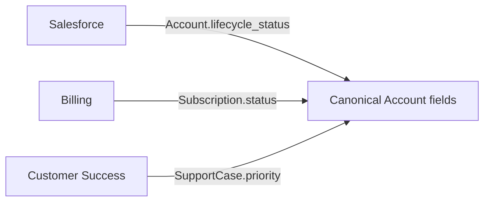

# ADR-0020: Assign Source of Truth at the Field Level

- **Decision ID:** D020 (P1.4 Decision A)
- **Status:** Accepted and implemented in the reference layer
- **Scope:** P1 canonical field ownership

## The Problem

One application is rarely authoritative for every field on a business entity. Declaring an entire Account to belong to Salesforce would incorrectly give Salesforce control over billing, usage, payment, and customer-health facts.

## Visual Diagram

Each arrow applies only to the named field, not the whole Account.

## Simple Example

Globex Health is an Account in Salesforce and a customer in the billing system. Salesforce owns its sales lifecycle, while billing owns its Subscription status. Neither system can overwrite the other's field. RevenueOS evaluates each proposed field independently.

## How We Implement It

| Component | Responsibility |
|---|---|
| `field-authority-policy.v1.json` | Maps each governed entity field to a domain and authoritative sources. |
| `AuthorityPolicy.field()` | Returns one approved field rule or applies the default-deny behavior. |
| `canonical_field_state` | Stores one current governed value and its provenance. |
| Canonical contract validation | Rejects policy entries for unknown entities or fields. |

## Why This Design

- **Rejected alternative:** Assign one master system to an entire entity.
- **Why rejected:** Different systems legitimately own different business facts on the same entity.
- **Why this is better:** Ownership is precise, reviewable, and compatible with the existing canonical model.
- **Tradeoff:** The matrix needs deliberate maintenance as governed fields are added.
