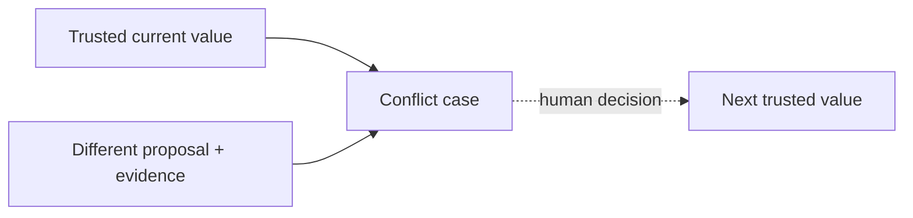

# ADR-0021: Preserve Conflicts and Protect Manually Verified Values

- **Decision ID:** D021 (P1.4 Decision B)
- **Status:** Accepted and implemented in the reference layer
- **Scope:** P1 field-value protection and history

## The Problem

Source systems can disagree, and even an authoritative system can later contradict a value a human verified. Silently choosing the newest value would destroy evidence and could replace known truth with a bad update.

## Visual Diagram

Conflicting input enters a review case; it does not overwrite the trusted value.

## Simple Example

Sarah Kim verifies that Globex Health is a prospect. HubSpot later reports a different lifecycle value. RevenueOS retains both values and their evidence while keeping the verified value current. A human must decide whether anything changes.

## How We Implement It

| Component | Responsibility |
|---|---|
| `manual_verified` | Prevents an automated proposal from replacing reviewed truth. |
| `field_conflict` | Preserves current and proposed values, source evidence, owner, and status. |
| `field_value_history` | Appends every accepted value and verification with its predecessor. |
| `AuthorityStore.apply_change()` | Opens review instead of overwriting protected or competing truth. |

## Why This Design

- **Rejected alternative:** Last-write-wins or destructive replacement.
- **Why rejected:** Arrival time does not prove correctness, and overwrites erase useful evidence.
- **Why this is better:** Trusted state stays stable while every disagreement remains explainable.
- **Tradeoff:** Conflicts can remain open and require operational stewardship.
