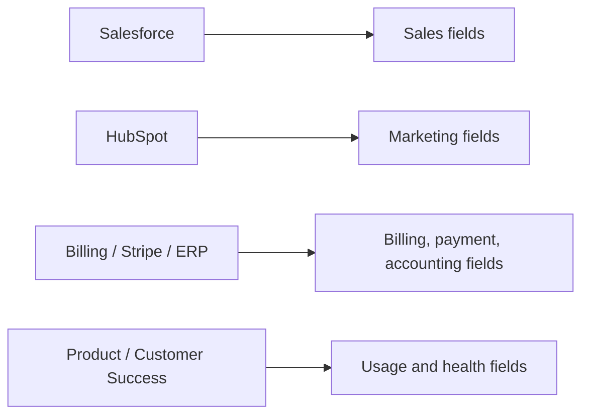

# ADR-0022: Give Each Business Domain Its Own Authoritative Systems

- **Decision ID:** D022 (P1.4 Decision C)
- **Status:** Accepted and implemented in the reference layer
- **Scope:** P1 domain ownership

## The Problem

Sales, marketing, enrichment, product usage, billing, payments, accounting, customer health, and consent are created by different operational systems. Treating all sources as equally authoritative would let a marketing or enrichment update replace financial or consent truth.

## Visual Diagram

The arrows describe ownership domains, not a running cross-system workflow.

## Simple Example

Salesforce reports Globex Health's Opportunity stage, Stripe reports a payment, and the product reports Sarah Kim's last activity. RevenueOS accepts each only for its approved domain. HubSpot cannot become payment truth because it received a copied payment value. Consent remains reserved for a verified consent source.

## How We Implement It

| Domain | Authoritative systems |
|---|---|
| Sales / marketing | Salesforce / HubSpot |
| Enrichment / usage | Clay and Apollo / product systems |
| Billing / payments / accounting | Billing / Stripe / Enterprise Resource Planning (ERP) |
| Customer health / consent | Customer Success (CS) / verified consent registry |

## Why This Design

- **Rejected alternative:** Use a global source ranking for every field.
- **Why rejected:** A source can be authoritative in one domain and only a consumer in another.
- **Why this is better:** Domain expertise determines ownership while field rules provide precise enforcement.
- **Tradeoff:** Cross-domain fields need an explicit policy rather than an assumed universal ranking.
