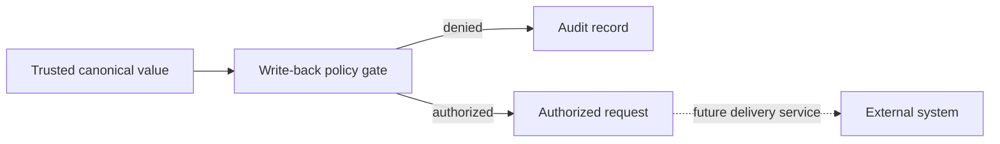

# ADR-0023: Authorize Write-Back Explicitly and Audit Every Decision

- **Decision ID:** D023 (P1.4 Decision D)
- **Status:** Accepted and implemented as authorization-only in the reference layer
- **Scope:** P1 outbound write authority

## The Problem

Automatically synchronizing every canonical change to every source can create loops, overwrite local workflows, and spread an incorrect value. RevenueOS needs a narrow permission decision before any future delivery service writes to an operational system.

## Visual Diagram

P1.4 ends at authorization; the dashed delivery step is not implemented.

## Simple Example

An automatic process tries to push Globex Health's lifecycle to HubSpot and is denied. Sarah Kim submits the reviewed canonical value with data-steward authority and a resolved conflict reference. P1.4 records authorization. It does not call HubSpot or send the value.

## How We Implement It

| Component | Responsibility |
|---|---|
| `write_back_policy` | Requires an authorized role and resolved review evidence. |
| Field `write_back_targets` | Limits which systems may receive each governed field. |
| `AuthorityStore.evaluate_write_back()` | Compares the requested value with current canonical truth. |
| `write_back_request` | Records every authorization or denial as immutable history. |

## Why This Design

- **Rejected alternative:** Unrestricted automatic bidirectional synchronization.
- **Why rejected:** It creates feedback loops and gives background jobs excessive authority.
- **Why this is better:** Every future write has a known actor, approved target, reviewed value, and audit trail.
- **Tradeoff:** Authorization adds latency, and a separate delivery service is still required.
