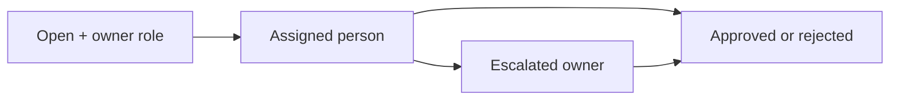

# ADR-0024: Make People Accountable for Conflict Resolution

- **Decision ID:** D024 (P1.4 Decision E)
- **Status:** Accepted and implemented in the reference layer
- **Scope:** P1 data stewardship workflow

## The Problem

A conflict is not resolved merely because it was detected. It needs a responsible owner, evidence, a visible status, escalation when necessary, and an immutable record of who made the final decision.

## Visual Diagram

Arrows show review status changes; every transition appends an audit event.

## Simple Example

The Globex Health lifecycle conflict starts in the Revenue Operations queue. Sarah Kim is assigned as the reviewer. She can approve the proposed value, keep the current value, or escalate the case. RevenueOS records every step and reason.

## How We Implement It

| Component | Responsibility |
|---|---|
| `assigned_owner_role`, `assigned_owner_id` | Identify the responsible queue and person. |
| Conflict statuses | Track `open`, `escalated`, `approved`, or `rejected`. |
| `conflict_review_event` | Preserves assignment, escalation, and decision history. |
| Reviewer authorization | Limits decisions to the assigned role/person or a data steward. |

## Why This Design

- **Rejected alternative:** A shared unowned queue or automatic tie-breaker.
- **Why rejected:** Unowned cases stagnate, while automatic tie-breakers cannot judge business evidence safely.
- **Why this is better:** Accountability and evidence make decisions traceable and recoverable.
- **Tradeoff:** Human review requires staffing, service-level expectations, and future user interfaces.
