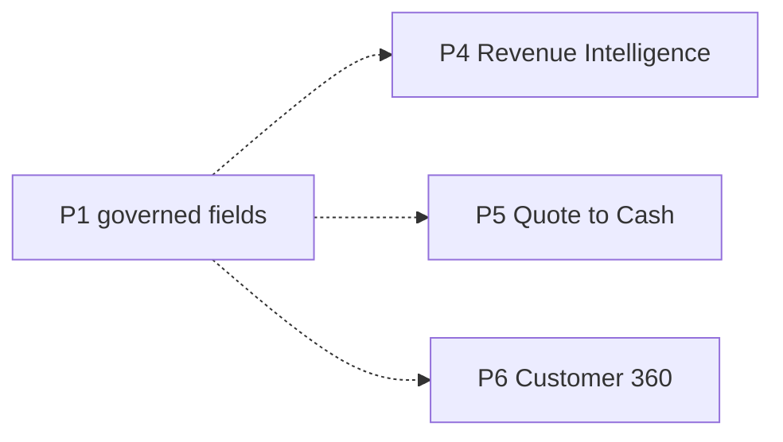

# ADR-0025: Reserve Future Authority Boundaries Without Building Future Products

- **Decision ID:** D025 (P1.4 Decision F)
- **Status:** Accepted and implemented as policy boundaries in the reference layer
- **Scope:** P1 compatibility with later RevenueOS projects

## The Problem

Revenue intelligence, quote-to-cash, and Customer 360 will need trusted sales, subscription, billing, usage, finance, health, and consent data. Building those workflows in P1.4 would mix project boundaries, but ignoring them would invite later systems to create competing truth.

## Visual Diagram

Solid arrows show governed P1 fields; dashed arrows show future consumers, not implemented workflows.

## Simple Example

P1.4 records that billing owns Subscription status and Stripe owns payments. A future P5 workflow may consume those governed values. It cannot silently redefine their owners. P1.4 does not build invoicing, forecasting, health scoring, or consent workflows.

## How We Implement It

| Component | Responsibility |
|---|---|
| Canonical field validation | Keeps policies aligned with the existing 23-entity contract. |
| Domain matrix | Reserves ownership for sales, usage, billing, payments, accounting, health, and consent. |
| `future_extension_points` | Documents policy-only or not-yet-implemented boundaries. |
| Default deny | Requires an approved field rule before later systems can write canonical truth. |

## Why This Design

- **Rejected alternative:** Build P4–P6 workflows now or leave later ownership undefined.
- **Why rejected:** Early workflows expand scope; undefined authority creates inconsistent truth later.
- **Why this is better:** Later projects receive stable governance boundaries without premature implementation.
- **Tradeoff:** New canonical fields or consent structures still need explicit architecture approval before use.
