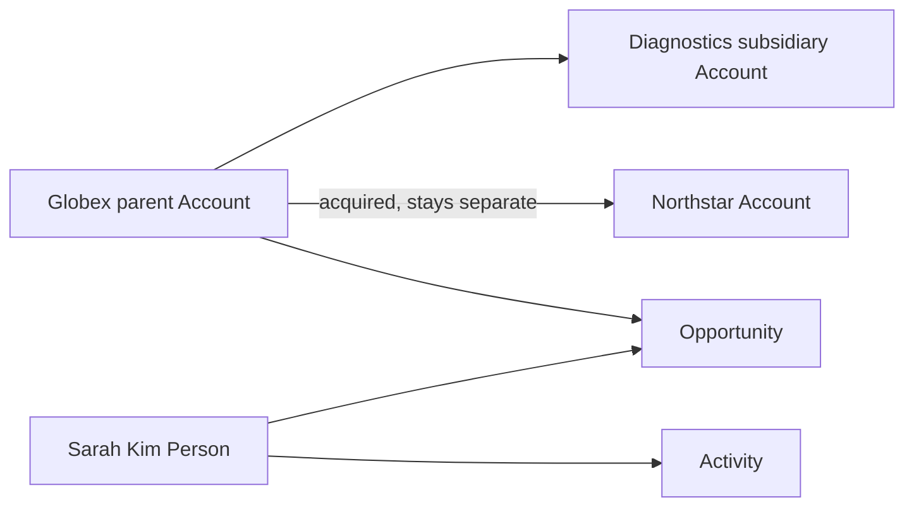

# ADR-0026: Generate One Connected Fictional Business Ecosystem

- **Decision ID:** D026 (P1.5 Decision A)
- **Status:** Accepted and implemented in the synthetic generator
- **Scope:** P1 test and learning fixtures

## The Problem

Independent sample rows cannot prove that company hierarchies, people, opportunities, and activities stay connected. P1 needs realistic fictional records that exercise the approved relationships without using customer data.

## Visual Diagram

The arrows are fixture relationships, not running workflows.

## Simple Example

Globex Health owns Globex Diagnostics and later acquires Northstar Labs. The three companies keep separate Account IDs. Sarah Kim, a Globex employee, participates in an Opportunity and a meeting Activity. Every fixture reference points to a generated parent record.

## How We Implement It

| Component | Responsibility |
|---|---|
| `generate_dataset()` | Builds connected companies, people, employment, opportunities, and activities. |
| Canonical fixture IDs | Reuse P1.2 entity prefixes and deterministic UUIDv7 values. |
| Source object IDs | Keep Salesforce and HubSpot identifiers separate from canonical IDs. |
| Relationship validation | Rejects unknown parents, people, Accounts, or Opportunities. |

## Why This Design

- **Rejected alternative:** Generate unrelated rows or copy production data.
- **Why rejected:** Isolated rows miss relationship failures, while production data creates privacy and security risk.
- **Why this is better:** One fictional ecosystem tests realistic joins without exposing real people or companies.
- **Tradeoff:** The fixtures simplify many business details and are not a statistical model of a real market.
