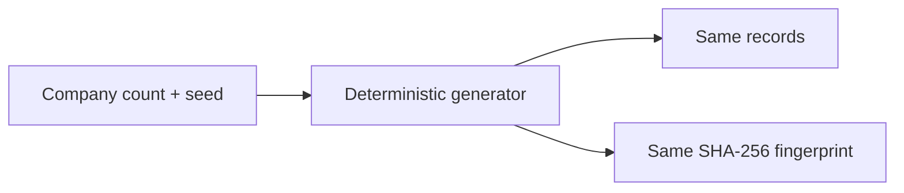

# ADR-0027: Make Synthetic Generation Deterministic and Configurable

- **Decision ID:** D027 (P1.5 Decision B)
- **Status:** Accepted and implemented in the synthetic generator
- **Scope:** P1 fixture reproducibility and scale

## The Problem

Random test data is difficult to debug when every run changes. RevenueOS also needs small learning fixtures and larger validation datasets without maintaining several hand-written copies.

## Visual Diagram

## Simple Example

Sarah runs the 250-company generator twice with seed `42`. Both runs create identical identifiers, values, files, and Secure Hash Algorithm 256-bit (SHA-256) fingerprints. Changing the seed changes generated values while preserving the requested shape. Presets support 25, 250, and 2,500 companies, and custom sizes start at three.

## How We Implement It

| Component | Responsibility |
|---|---|
| `GenerationConfig` | Validates company count, seed, and the version 1 ecosystem shape. |
| Local `random.Random` | Prevents generator state from depending on global randomness. |
| `_StableIds` | Derives deterministic prefixed UUIDv7 fixture IDs from seed and logical key. |
| `SyntheticDataset.fingerprint()` | Hashes the complete normalized dataset for comparison. |

## Why This Design

- **Rejected alternative:** Use current time and uncontrolled random values on every run.
- **Why rejected:** Failures could not be reproduced or compared reliably.
- **Why this is better:** One command can recreate the exact evidence used by a test or review.
- **Tradeoff:** A seed provides reproducibility, not secrecy; generated values must never be treated as anonymous production data.
