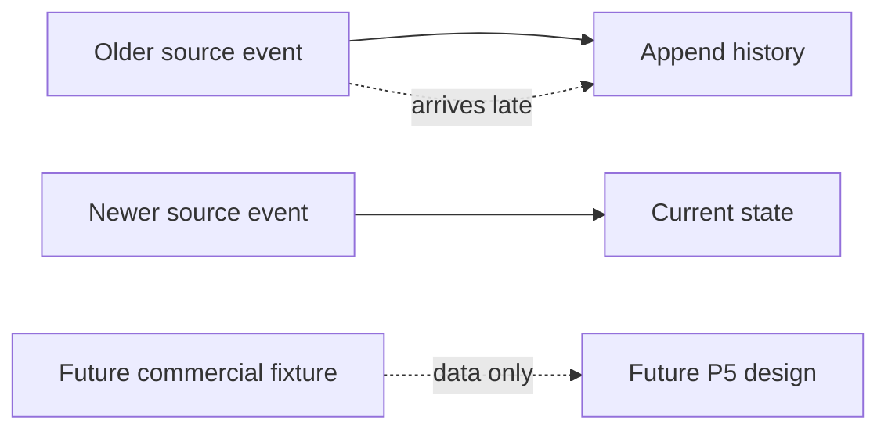

# ADR-0029: Generate Historical Timelines Without Building Future Workflows

- **Decision ID:** D029 (P1.5 Decision D)
- **Status:** Accepted and implemented in the synthetic generator
- **Scope:** P1 history and boundary fixtures

## The Problem

Current-state-only fixtures cannot test rebrands, job changes, acquisitions, or late source events. Synthetic future commercial records can help later design, but they must not imply that subscription or renewal workflows already exist.

## Visual Diagram

## Simple Example

Northstar Research rebrands to Northstar Labs while keeping one Account ID. A Globex update dated April 15 arrives after an April 20 update, so it is historical rather than current. Sarah Kim's former Northstar employment closes before her Globex role begins. No subscription, renewal, or billing workflow runs.

## How We Implement It

| Component | Responsibility |
|---|---|
| `account_name_history` | Preserves old and current effective-dated company names. |
| `employment_history` | Keeps a Person stable while employer and job title change. |
| P1.3 event timestamps | Separate source update time from observation time for late arrival. |
| Manifest boundaries | Mark future workflows and live source behavior as not implemented. |

## Why This Design

- **Rejected alternative:** Overwrite old values or implement P5 behavior inside P1 fixtures.
- **Why rejected:** Overwrites erase history, while early workflows cross approved project boundaries.
- **Why this is better:** P1 can validate temporal behavior without claiming downstream functionality.
- **Tradeoff:** Fixtures show selected history cases, not a complete event-sourcing or subscription model.
