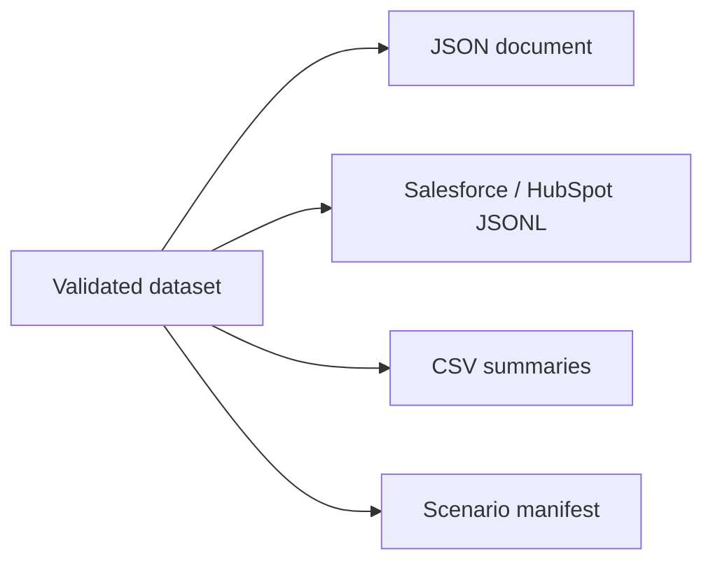

# ADR-0030: Publish Portable Synthetic Files with Automated Validation

- **Decision ID:** D030 (P1.5 Decision E)
- **Status:** Accepted and implemented in the synthetic generator
- **Scope:** P1 synthetic data outputs

## The Problem

Engineers need source-like records for programs and readable summaries for review. One opaque format would either be inconvenient for automation or difficult for people to inspect.

## Visual Diagram

## Simple Example

The 25-company Globex run writes Salesforce and HubSpot JavaScript Object Notation Lines (JSONL), one complete JavaScript Object Notation (JSON) document, readable Comma-Separated Values (CSV) summaries, and a scenario manifest. Validation checks every source envelope and relationship before files are written. Repeating the same command produces byte-identical files. Generated bulk files stay outside Git.

## How We Implement It

| Component | Responsibility |
|---|---|
| `write_dataset()` | Writes deterministic JSON, JSONL, CSV, and manifest files. |
| `synthetic-dataset-manifest.v1.json` | Defines the version 1 manifest contract. |
| `validate_dataset()` | Checks relationships, IDs, source contracts, expected issues, and authority assumptions. |
| `.gitignore` | Excludes the recommended `generated-data/` output directory. |

## Why This Design

- **Rejected alternative:** Commit large generated datasets or publish only one binary/database format.
- **Why rejected:** Generated bulk files bloat history, and opaque formats make review harder.
- **Why this is better:** Programs receive structured source events while people receive concise summaries and expectations.
- **Tradeoff:** Multiple files require a manifest and synchronized validation to stay understandable.
