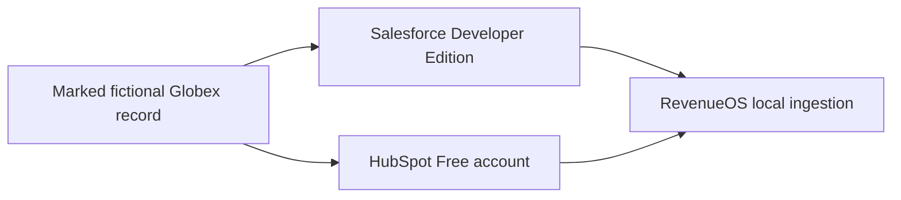

# ADR-0031: Use Controlled Live CRM Accounts

- **Decision ID:** D031 (P1.6 Decision A)
- **Status:** Accepted; connector implemented, real-account verification pending
- **Scope:** P1.6 Salesforce and HubSpot verification

## The Problem

Mock responses prove code paths but cannot prove real permissions, response shapes, or account settings. Testing against normal CRM records could change data that does not belong to the exercise.

## Visual Diagram

## Simple Example

RevenueOS creates `[SAI TEST] Globex Health` only when the explicit test marker and test domain are safe. A matching unmarked Account or Company causes the seeder to stop. Repeating the seed confirms the same test record instead of creating another. No normal CRM record is modified.

## How We Implement It

| Component | Responsibility |
|---|---|
| `ensure_globex_test_account()` | Creates or confirms only the marked Salesforce Account. |
| `ensure_globex_test_company()` | Creates or confirms only the marked HubSpot Company. |
| `--confirm-test-write` | Requires deliberate approval before a seed or update request. |
| `SAI_REVENUEOS_P16_TEST_ONLY` | Distinguishes fictional P1.6 records from normal records. |

## Why This Design

- **Rejected alternative:** Test against existing business records or mocks only.
- **Why rejected:** Existing records are unsafe to change; mocks cannot prove real access.
- **Why this is better:** Small marked fixtures provide real API evidence with a narrow write boundary.
- **Tradeoff:** The user must configure and periodically clean up test records in both accounts.
