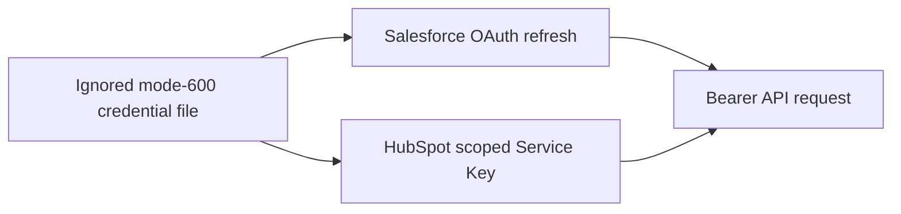

# ADR-0032: Use Scoped Vendor Authentication

- **Decision ID:** D032 (P1.6 Decision B)
- **Status:** Accepted and implemented; live credentials are not present in the repository
- **Scope:** P1.6 connector authentication

## The Problem

Live connectors need API access without exposing passwords or long-lived credentials in Git, terminal output, or logs. Each vendor now has a different supported system-to-system authentication model.

## Visual Diagram

## Simple Example

Sai authorizes a Salesforce External Client App in the browser using OAuth 2.0 and Proof Key for Code Exchange (PKCE). RevenueOS stores the refresh token only in ignored local storage. A scoped HubSpot Service Key is entered through hidden terminal input. Request traces show the method and URL but never either token.

## How We Implement It

| Component | Responsibility |
|---|---|
| `configure_live_auth.py` | Performs local Salesforce browser authorization or hidden HubSpot token entry. |
| `SalesforceOAuthFile` | Refreshes expired Salesforce access tokens and supports refresh-token rotation. |
| `HubSpotAccessToken` | Supplies a scoped Service Key or an existing private-app token. |
| `JsonHttpClient` | Redacts authorization values from diagnostics and errors. |

## Why This Design

- **Rejected alternative:** Store passwords, tokens, or client secrets in source files or command history.
- **Why rejected:** Those values can leak through Git, screenshots, shell history, and CI logs.
- **Why this is better:** Vendor-supported scoped tokens are revocable and stay outside repository history.
- **Tradeoff:** Initial authorization requires a human and tokens still require rotation and local protection.
