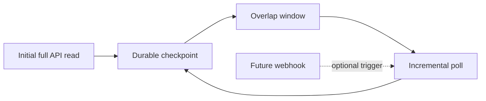

# ADR-0033: Run a Full Sync Before Incremental Polling

- **Decision ID:** D033 (P1.6 Decision C)
- **Status:** Accepted and implemented in the connectors
- **Scope:** P1.6 extraction behavior

## The Problem

RevenueOS needs a complete starting point and must then capture changes without downloading every record forever. Polling also needs a clear future boundary for webhooks and reconciliation.

## Visual Diagram

## Simple Example

The first Globex run reads the complete Salesforce Account or HubSpot Company. A later run requests records changed since the saved checkpoint minus five minutes. An update becomes a new source version, while an API deletion becomes a tombstone. Future webhooks may trigger faster reads but do not replace periodic reconciliation.

## How We Implement It

| Component | Responsibility |
|---|---|
| `SalesforceConnector.fetch_records()` | Uses QueryAll for the first read and Get Updated/Get Deleted for later reads. |
| `HubSpotConnector.fetch_records()` | Pages active and archived objects, then searches by last-modified time. |
| `LiveIngestionRunner.sync()` | Selects initial or incremental mode and applies the overlap window. |
| P1.3 `SourceEvent` | Carries each vendor record through one unchanged ingestion contract. |

## Why This Design

- **Rejected alternative:** Repeat full extracts forever or depend on webhooks immediately.
- **Why rejected:** Full-only polling wastes API limits; webhook-only ingestion can miss events during outages.
- **Why this is better:** Full plus incremental polling is simple, recoverable, and ready for later webhook triggers.
- **Tradeoff:** Polling has latency, and no-change polls currently leave the last data checkpoint unchanged.
