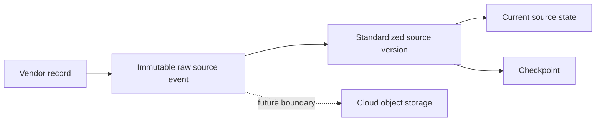

# ADR-0034: Store Live Data Raw-First in the Existing Local Reference

- **Decision ID:** D034 (P1.6 Decision D)
- **Status:** Accepted and implemented in the local reference
- **Scope:** P1.6 operational storage

## The Problem

Live responses must remain recoverable even when standardization fails. P1.6 also needs reliable local execution without prematurely introducing cloud storage or a warehouse.

## Visual Diagram

## Simple Example

Salesforce returns a Globex Account with an unmodeled custom field. RevenueOS stores the complete returned record before selecting the essential Account fields. If validation fails, the raw event remains available and the checkpoint does not move. The same source envelope can later be stored in managed cloud infrastructure.

## How We Implement It

| Component | Responsibility |
|---|---|
| P1.3 `SourceStore` | Stores raw events first, immutable versions, current state, and checkpoints. |
| P1.2 `IdentityStore` | Registers the four-part source identity without approving a match. |
| Local SQLite files | Provide transactions and repeatable learning evidence. |
| `generated-data/p16-live/` | Keeps local databases and credentials outside Git. |

## Why This Design

- **Rejected alternative:** Standardize before storage or build Snowflake/cloud storage now.
- **Why rejected:** Early standardization loses evidence; cloud infrastructure exceeds P1.6 scope.
- **Why this is better:** Existing tested transactions preserve vendor truth and minimize new moving parts.
- **Tradeoff:** Local SQLite is not a distributed or highly available production platform.
