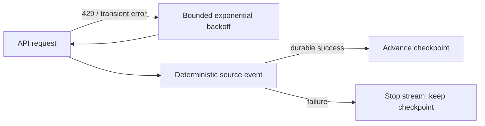

# ADR-0035: Bound Retries and Protect Checkpoints

- **Decision ID:** D035 (P1.6 Decision E)
- **Status:** Accepted and implemented in the connector runtime
- **Scope:** P1.6 reliability

## The Problem

Network failures, rate limits, and malformed records are normal integration conditions. Unbounded retries can overload a vendor, while moving a checkpoint past failed data creates a silent gap.

## Visual Diagram

## Simple Example

Salesforce briefly resets the Globex request. RevenueOS retries with bounded exponential delays and honors `Retry-After` for rate limits. If the request or durable processing still fails, that object stream stops without crossing the failed position. A later overlap replay processes the same deterministic event only once.

## How We Implement It

| Component | Responsibility |
|---|---|
| `RetryPolicy` | Caps attempts and exponential delay with jitter. |
| `JsonHttpClient` | Retries safe reads and selected idempotent requests for transient status codes. |
| `VendorRecord.to_event()` | Produces a deterministic ID for one source version. |
| `LiveIngestionRunner` | Isolates object streams and stops a failed stream before a checkpoint gap. |

## Why This Design

- **Rejected alternative:** Retry forever, fail the whole connector, or advance after partial success.
- **Why rejected:** Those choices cause vendor pressure, broad outages, or missing records.
- **Why this is better:** Failures remain visible, bounded, isolated, and safe to replay.
- **Tradeoff:** A persistent bad record blocks that object stream until it is corrected or deliberately handled.
