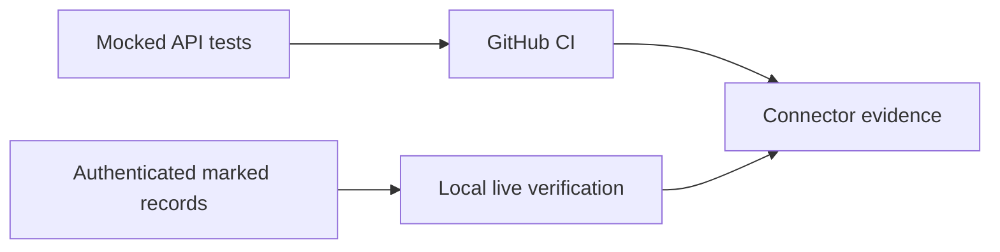

# ADR-0036: Verify Connectors with Mocks and Live Accounts

- **Decision ID:** D036 (P1.6 Decision F)
- **Status:** Accepted; mocked CI verification implemented, authenticated verification pending
- **Scope:** P1.6 verification

## The Problem

Continuous Integration (CI) must be deterministic and cannot contain real credentials. Mock-only tests still cannot prove that current vendor authentication, scopes, and response behavior work in Sai's accounts.

## Visual Diagram

## Simple Example

GitHub CI simulates Globex pagination, updates, deletions, rate limits, and failures with no credentials. Sai then authorizes both test accounts locally and runs the same connector boundary against marked Globex records. RevenueOS reports Salesforce and HubSpot separately. A platform remains unverified until its real API call succeeds.

## How We Implement It

| Component | Responsibility |
|---|---|
| `test_live_connectors.py` | Exercises vendor clients and recovery with scripted API responses. |
| `demo_live_ingestion.py` | Shows the complete mocked Globex flow in 10–15 lines. |
| `run_live_ingestion.py` | Runs authenticated initial/incremental checks and credential-free traces. |
| GitHub Actions | Runs mocks only and never receives vendor secrets. |

## Why This Design

- **Rejected alternative:** Put live credentials in CI or trust mocks as proof of production access.
- **Why rejected:** CI secrets expand risk; mocks cannot validate an actual account configuration.
- **Why this is better:** Deterministic automation and explicit live evidence cover different failure classes.
- **Tradeoff:** Live verification is manual, depends on vendor availability, and can drift after tokens or permissions change.
