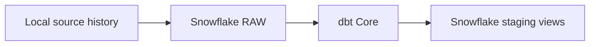

# ADR-0037: Use Snowflake and dbt Core for the Warehouse Layer

- **Decision ID:** D037 (P1.7 Decision A)
- **Status:** Accepted; authenticated verification complete
- **Scope:** P1.7 warehouse and transformation platform

## The Problem

P1.3–P1.6 preserve source history locally, but RevenueOS also needs a real warehouse transformation boundary. A local substitute would not prove Snowflake permissions, SQL behavior, cost controls, or dbt Core connectivity.

## Visual Diagram

## Simple Example

HubSpot returns several versions of the fictional Globex Health Company. RevenueOS loads each version into Snowflake RAW and dbt turns the nested payload into typed staging columns. Replaying the load adds no duplicate event. DuckDB is not used as a substitute for this verification.

## How We Implement It

| Component | Responsibility |
|---|---|
| `RAW.SOURCE_EVENT` | Retains complete P1.3/P1.6 envelopes and vendor payloads. |
| `dbt-snowflake` | Runs dbt Core models and tests against Snowflake. |
| `SAI_REVENUEOS_XS` | Provides X-Small, auto-suspending compute. |
| Resource monitor | Warns and suspends the warehouse at defined credit thresholds. |

## Why This Design

- **Rejected alternative:** Use DuckDB or only mocked Snowflake behavior.
- **Why rejected:** It cannot prove the approved production-oriented platform boundary.
- **Why this is better:** The same SQL, permissions, tests, and lineage run on real Snowflake.
- **Tradeoff:** Authenticated verification can consume limited Snowflake credits and requires deliberate account setup.
