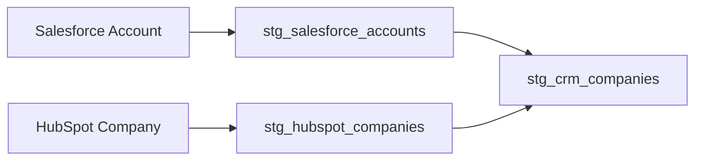

# ADR-0038: Standardize CRM Records Without Losing Their Source Identity

- **Decision ID:** D038 (P1.7 Decision B)
- **Status:** Accepted; authenticated verification complete
- **Scope:** P1.7 staging models

## The Problem

Salesforce and HubSpot use different object names and payload shapes for similar business concepts. Flattening them without provenance could hide which tenant, source record, event, or raw value produced a staged row.

## Visual Diagram

The final arrows are logical normalization, not an identity merge or write-back workflow.

## Simple Example

Salesforce calls Globex an Account while HubSpot calls it a Company. Both staging models expose consistent fields such as `name`, `domain`, and `country`. They still retain separate source systems, tenants, object IDs, event IDs, timestamps, and raw payloads. P1.7 never claims the two records are one canonical Account.

## How We Implement It

| Component | Responsibility |
|---|---|
| Seven source models | Cover the four Salesforce and three HubSpot v1 objects. |
| `stg_crm_companies` | Presents Accounts and Companies with one consistent column set. |
| Provenance columns | Retain source key, event, trace, checkpoint, and hashes. |
| `raw_payload_json` | Keeps the complete vendor payload available beside typed values. |

## Why This Design

- **Rejected alternative:** Replace source fields with one flattened company table.
- **Why rejected:** It would hide vendor evidence and imply an unapproved identity merge.
- **Why this is better:** Consumers receive consistent fields without losing traceability.
- **Tradeoff:** Staging rows carry more metadata and source-specific models still exist.
