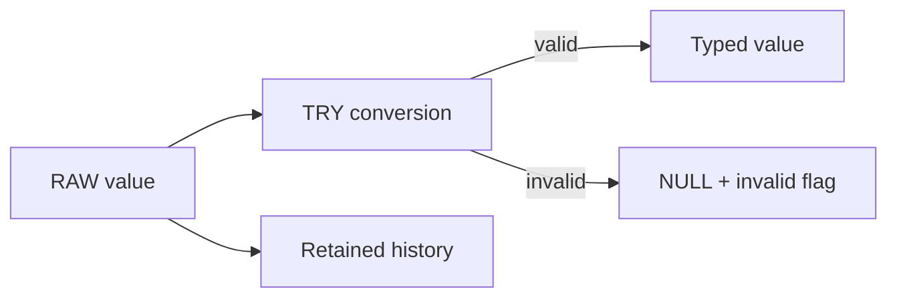

# ADR-0039: Make Invalid, Historical, and Late Data Visible

- **Decision ID:** D039 (P1.7 Decision C)
- **Status:** Accepted; authenticated verification complete
- **Scope:** P1.7 normalization behavior

## The Problem

Source values can be blank, malformed, deleted, repeated, or received out of order. A strict cast could stop the whole model, while silent coercion or overwrite could destroy evidence.

## Visual Diagram

## Simple Example

Northstar Labs sends an invalid Opportunity amount after a valid older version. dbt keeps both raw events, converts the bad amount to `NULL`, and marks the conversion invalid. A quality test fails instead of silently replacing the good value. The arrival order and source timestamps remain available for diagnosis.

## How We Implement It

| Component | Responsibility |
|---|---|
| `TRY_TO_*` conversions | Return `NULL` instead of aborting on malformed values. |
| Validity flags | Distinguish missing optional values from invalid supplied values. |
| `is_latest_source_version` | Labels one latest version without deleting history. |
| `is_late_arriving` | Identifies an older source update received after a newer one. |

## Why This Design

- **Rejected alternative:** Fail every model on cast or overwrite older versions.
- **Why rejected:** One bad field would block good records, and overwrite would erase history.
- **Why this is better:** Invalid data is observable, testable, and recoverable.
- **Tradeoff:** Consumers must check validity flags and choose the correct historical version.
