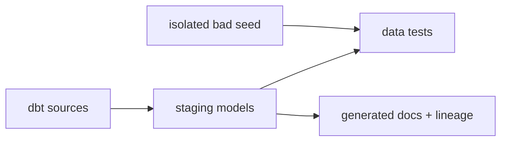

# ADR-0040: Make Warehouse Quality and Lineage Executable

- **Decision ID:** D040 (P1.7 Decision D)
- **Status:** Accepted; authenticated verification complete
- **Scope:** P1.7 testing, documentation, and learning evidence

## The Problem

Successful model creation does not prove that keys, required values, relationships, history, or types are correct. Learners also need visible lineage and a safe way to see a test fail for the right reason.

## Visual Diagram

## Simple Example

An isolated fictional Globex row has no company name. Its tagged `not_null` test fails and dbt identifies the exact bad field. The normal build excludes this seed, and the demonstration removes its table afterward. Generated documentation still shows how RAW feeds each staging model.

## How We Implement It

| Component | Responsibility |
|---|---|
| Generic dbt tests | Check uniqueness, required values, accepted values, and relationships. |
| Singular SQL tests | Check timestamps, payload identity, types, latest versions, and history parity. |
| `dbt docs generate` | Produces the model catalog and lineage graph. |
| `demo_dbt_failure.py` | Creates, detects, and cleans up one isolated expected failure. |

## Why This Design

- **Rejected alternative:** Rely on successful SQL execution and written assurances.
- **Why rejected:** Neither reveals silent quality drift or proves failure behavior.
- **Why this is better:** Quality, lineage, and recovery are repeatable commands with evidence.
- **Tradeoff:** More tests increase warehouse queries and require intentional maintenance as contracts evolve.
