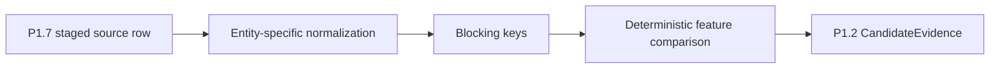

# ADR-0041: Match Accounts and People with Explainable Rules

- **Decision ID:** D041 (P1.8 Decision A)
- **Status:** Accepted and implemented in the reference layer
- **Scope:** P1 Account and Person candidate generation

## The Problem

Source records do not carry a canonical RevenueOS identifier. Matching every record to every identity is expensive, while opaque scoring would make incorrect links difficult to explain.

## Visual Diagram

Arrows show data movement. The matcher proposes evidence; it does not create truth.

## Simple Example

Salesforce stores `Globex Health`, while HubSpot stores `Globex Health, Inc.`. Their normalized domain is the same and their normalized names agree. RevenueOS records those feature results and a score against the existing Globex Account. The original values remain unchanged in source history.

## How We Implement It

| Component | Responsibility |
|---|---|
| `STG_CRM_COMPANIES`, `STG_CRM_PEOPLE` | Supply latest P1.7 Account and Person evidence with source identity and provenance. |
| `normalization.py` | Normalizes company names, domains, person names, and emails for comparison only. |
| `matcher.py` | Applies versioned Account or Person blocking, weights, negative evidence, and thresholds. |
| `identity-resolution-policy.v1.json` | Makes every input model, feature weight, and threshold reviewable. |

## Why This Design

- **Rejected alternative:** Begin with a machine-learning matcher or compare every pair.
- **Why rejected:** Both add complexity; an opaque model also makes evidence harder to defend.
- **Why this is better:** Deterministic rules are testable, replayable, and explainable from the first implementation.
- **Tradeoff:** Rules require maintenance and will miss some legitimate matches that lack useful Account or Person evidence.
