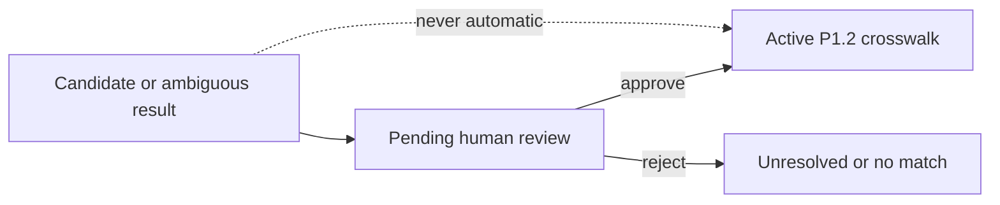

# ADR-0042: Require Human Approval for Every New Crosswalk

- **Decision ID:** D042 (P1.8 Decision B)
- **Status:** Accepted and implemented in the reference layer
- **Scope:** P1 identity decision boundary

## The Problem

A high deterministic score is still evidence, not identity truth. Domains can be shared by related companies, and email addresses can be reused, mistyped, or represent shared mailboxes.

## Visual Diagram

Only the steward action can cross the authoritative boundary.

## Simple Example

Globex Health produces one strong Account candidate. RevenueOS opens review and leaves the HubSpot Company unmapped. Sarah Kim verifies the evidence and approves it. Only then does P1.2 create the active crosswalk.

## How We Implement It

| Component | Responsibility |
|---|---|
| `ResolutionService.resolve()` | Proposes P1.2 evidence and opens review without activating a mapping. |
| `identity_review_work_item` | Stores owner, candidate choices, expected case version, and status. |
| `ResolutionService.approve()` | Requires `p1_identity_steward`, records the decision, then calls P1.2 activation. |
| P1.2 constraints | Keep one active mapping per source and reject unauthorized decisions. |

## Why This Design

- **Rejected alternative:** Auto-activate an exact-key or high-score candidate.
- **Why rejected:** Current domains and emails are not independently verified unique identifiers.
- **Why this is better:** Every authoritative mapping has a named reviewer and preserved evidence.
- **Tradeoff:** Review volume is higher until measured precision supports a separately approved automation policy.
