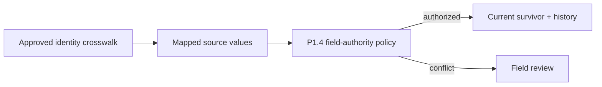

# ADR-0043: Select Surviving Values with Field Authority

- **Decision ID:** D043 (P1.8 Decision C)
- **Status:** Accepted and implemented in the reference layer
- **Scope:** P1 post-resolution field survivorship

## The Problem

Matching two source records does not decide which field value is correct. Using the match score or newest arrival would bypass P1.4 ownership and could overwrite manually verified truth.

## Visual Diagram

The match and field-value decisions remain separate.

## Simple Example

Salesforce says Globex Health is a customer, while HubSpot says it is a marketing-qualified lead. P1.4 keeps the Salesforce sales-lifecycle value current. The HubSpot value and evidence remain in a conflict case. The Account match score never chooses the lifecycle value.

## How We Implement It

| Component | Responsibility |
|---|---|
| `field-authority-policy.v1.json` | Remains the source of truth for governed field ownership. |
| `ResolutionService.apply_survivorship()` | Extracts only approved fields from latest mapped staging rows. |
| `AuthorityStore.apply_change()` | Applies authority, manual protection, provenance, history, and conflict rules. |
| P1.7 latest-version flags | Prevent late or historical rows from becoming current input. |

## Why This Design

- **Rejected alternative:** Last-write-wins, completeness-wins, or match-score-wins.
- **Why rejected:** None proves business authority, and each can destroy reviewed truth.
- **Why this is better:** P1.8 reuses the approved field matrix and preserves every disagreement.
- **Tradeoff:** Fields without an approved P1.4 policy remain evidence rather than receiving a guessed survivor.
