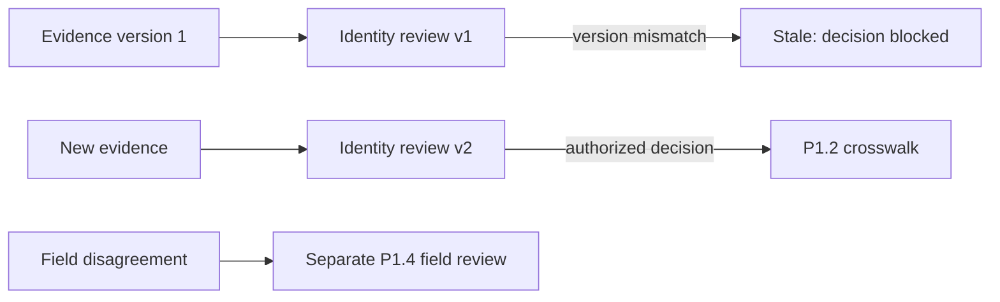

# ADR-0044: Version Resolution Runs and Protect Reviews from Stale Evidence

- **Decision ID:** D044 (P1.8 Decision D)
- **Status:** Accepted and implemented in the reference layer
- **Scope:** P1 resolution replay, re-evaluation, and manual review

## The Problem

Source evidence and policies change while a review is open. A delayed decision must not approve an older view of the evidence or silently remap an already governed identity.

## Visual Diagram

Identity and field reviews stay separate but can be presented together later.

## Simple Example

Sarah opens a review for one Globex candidate. Before she decides, a second company appears with the same domain. RevenueOS creates a new ambiguous run and marks the old review stale. Sarah must decide from the newer evidence instead of approving the old screen.

## How We Implement It

| Component | Responsibility |
|---|---|
| `resolution_run` | Stores the staged event, policy version, fingerprint, outcome, and evidence. |
| `match_candidate_result` | Preserves ranked feature results without becoming authoritative truth. |
| `expected_case_version` | Blocks decisions when the P1.2 resolution case changed after review opened. |
| Deterministic operation keys | Make matching, decisions, activation, and failure recovery idempotent. |
| `resolution_audit_event` | Appends processing, review, stale, approval, and failure history. |

## Why This Design

- **Rejected alternative:** Update one mutable score row or combine identity and field conflicts into one status.
- **Why rejected:** Mutable evidence hides history, while the two review types answer different questions.
- **Why this is better:** Every result is reproducible and delayed decisions cannot overwrite newer evidence.
- **Tradeoff:** Evidence and audit history grow, and production deployment will need retention and queue monitoring.
