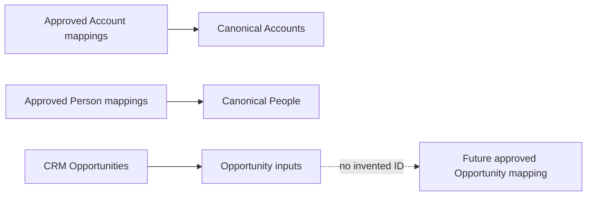

# ADR-0045: Publish Account and Person Before Broader Canonical Entities

- **Decision ID:** D045 (P1.9 Decision A)
- **Status:** Accepted and implemented
- **Scope:** P1 canonical Snowflake model coverage

## The Problem

Downstream projects need source-neutral identities, but P1.8 currently approves only Account and Person mappings. Creating canonical Opportunity or relationship IDs from source IDs would bypass P1 identity controls.

## Visual Diagram

## Simple Example

Salesforce and HubSpot Globex records have approved mappings to one Account. P1.9 publishes that Account and both source links. A Salesforce Opportunity may reference the approved Account, but it remains an unresolved Opportunity until its own canonical ID is approved. RevenueOS never turns the CRM Opportunity ID into a canonical ID.

## How We Implement It

| Component | Responsibility |
|---|---|
| `canonical_accounts`, `canonical_people` | Publish approved Account and Person identities. |
| `canonical_identity_crosswalks` | Exposes the current approved source links. |
| Relationship input model | Publishes Person/Account evidence only when both identities are approved. |
| `canonical_opportunity_inputs` | Standardizes pipeline data and resolves only its approved primary Account link. |

## Why This Design

- **Rejected alternative:** Create canonical IDs for every staged object immediately.
- **Why rejected:** That would bypass P1.2/P1.8 approval and change established identity rules.
- **Why this is better:** It delivers useful Account and Person models while keeping unsupported identities explicit.
- **Tradeoff:** Opportunity and relationship canonical entities remain incomplete until later approved identity work.
