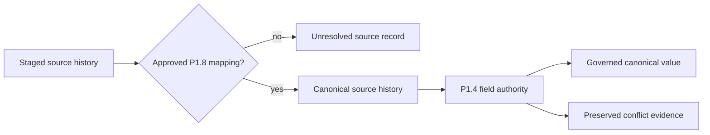

# ADR-0046: Require Approved Identity and Existing Field Authority

- **Decision ID:** D046 (P1.9 Decision B)
- **Status:** Accepted and implemented
- **Scope:** Canonical identity, survivorship, unresolved data, and history

## The Problem

A staged record is not automatically a canonical entity, and matching identity does not decide which field value is trusted. Promoting the latest or most complete value could silently override P1.4 authority.

## Visual Diagram

## Simple Example

Both Globex company records map to one approved Account. Salesforce may supply lifecycle status because P1.4 assigns it sales authority. HubSpot's different lifecycle remains conflict evidence instead of replacing Salesforce. Names and domains remain source evidence because P1.4 has not assigned their owner.

## How We Implement It

| Component | Responsibility |
|---|---|
| P1.8 publication tables | Store complete, versioned snapshots of active approved mappings. |
| Canonical source-history views | Preserve every mapped event, tombstone, late arrival, and provenance field. |
| `canonical_accounts` | Promotes only fields covered by existing P1.4 policy. |
| `unresolved_identity_records` | Keeps the latest unmapped Account/Person records separate and visible. |
| `canonical_field_conflict_evidence` | Preserves non-authoritative lifecycle disagreements for review. |

## Why This Design

- **Rejected alternative:** Last-write-wins or a source-priority list invented inside dbt.
- **Why rejected:** Arrival order is not authority, and a new priority list would contradict P1.4.
- **Why this is better:** Canonical values remain explainable from approved identity and ownership decisions.
- **Tradeoff:** Some canonical fields stay `NULL` until a source owner or manual truth is approved.
