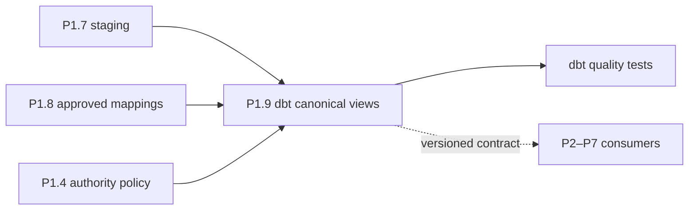

# ADR-0047: Publish Versioned and Tested Canonical dbt Models

- **Decision ID:** D047 (P1.9 Decision C)
- **Status:** Accepted and implemented
- **Scope:** Downstream canonical publication and validation

## The Problem

Projects P2–P7 need stable business models without learning Salesforce or HubSpot payload shapes. They also need clear proof that identity links, relationships, history, and unresolved boundaries remain valid.

## Visual Diagram

Arrows show data dependencies, not an automatic operational workflow.

## Simple Example

P1.9 publishes one canonical Globex Account with two approved source links. A future project reads `account_id` without parsing either CRM payload. dbt tests reject duplicate Accounts, unapproved mappings, broken relationships, or missing history. Rebuilding the views produces the same Account rather than a duplicate.

## How We Implement It

| Component | Responsibility |
|---|---|
| `canonical-warehouse-models.v1.json` | Defines the reusable model boundary and deferred capabilities. |
| dbt canonical views | Publish source-neutral identities, evidence, conflicts, and relationship inputs. |
| Generic and singular dbt tests | Validate keys, accepted states, mapping approval, authority, history, and relationships. |
| Identity publication hash | Makes an unchanged P1.8 mapping snapshot an idempotent replay. |

## Why This Design

- **Rejected alternative:** Give each downstream project direct access to CRM staging models.
- **Why rejected:** That would duplicate vendor logic and create inconsistent identity rules.
- **Why this is better:** One tested, versioned P1 boundary serves every later project.
- **Tradeoff:** Contract evolution and dbt model changes require coordinated compatibility review.
